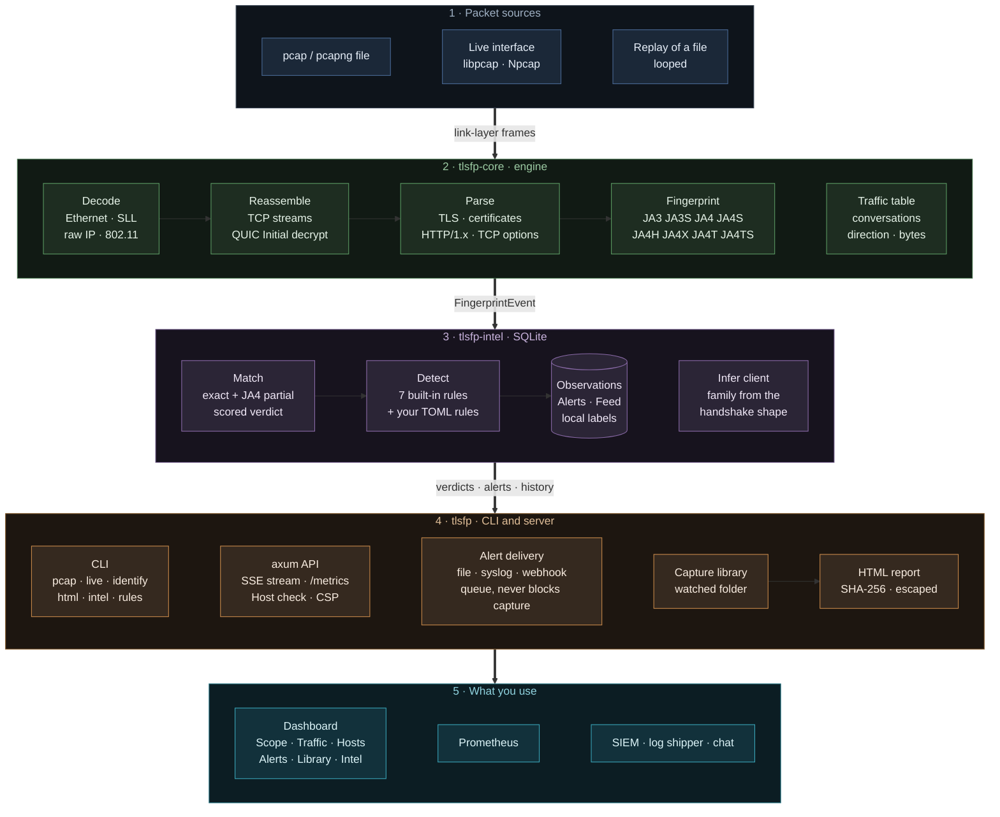

<div align="center">

# tlsfp

**Passive TLS fingerprinting for JA3 and the JA4+ family**

Reads packet captures or a live network interface, fingerprints every TLS and QUIC handshake, matches it against threat intelligence, and alerts when a client's fingerprint contradicts what it claims to be. It never transmits a packet.

[](https://github.com/TurlaFSB/JA3-JA4-TLS-FINGERPRINTING/actions/workflows/ci.yml)
[](https://github.com/TurlaFSB/JA3-JA4-TLS-FINGERPRINTING/releases)
[](LICENSE)
[](https://www.rust-lang.org)


[Quick start](#quick-start) · [Installation](docs/INSTALL.md) · [Usage](docs/USAGE.md) · [Dashboard](docs/DASHBOARD.md) · [Architecture](#architecture) · [Security](#security-and-responsible-use)

</div>


<sub>The dashboard replaying a vendored capture (`testdata/pcap/browsers-x509.pcapng`). Nothing on it is simulated.</sub>

---

## Contents

1. [Overview](#overview)
2. [Quick start](#quick-start)
3. [Installation](#installation)
4. [Usage](#usage)
5. [What it computes](#what-it-computes)
6. [Detection and intelligence](#detection-and-intelligence)
7. [Dashboard](#dashboard)
8. [Architecture](#architecture)
9. [Configuration and tuning](#configuration-and-tuning)
10. [Validation and performance](#validation-and-performance)
11. [Security and responsible use](#security-and-responsible-use)
12. [Limitations](#limitations)
13. [Documentation](#documentation)
14. [Roadmap](#roadmap)
15. [Contributing, citation, licence](#contributing-citation-licence)

---

## Overview

A TLS handshake begins in the clear. The ClientHello lists the protocol versions, cipher suites, extensions and curves a program supports, in an order that is characteristic of its TLS library and configuration. Hashing those choices gives a **fingerprint** that stays stable across connections, and that differs between a browser, `curl`, a Go service and a piece of malware.

`tlsfp` computes those fingerprints from traffic it only observes. No decryption, no keys, no active probing, and no change to the network.

**What it is for**

- Naming the software behind a connection without reading its content.
- Spotting a client that is not what it claims: a "browser" whose handshake belongs to a script, or an operating-system claim its TCP stack contradicts.
- Recognising known-malicious TLS stacks from public feeds, and noticing when an address starts using a new client.
- Producing evidence: per-capture HTML reports with the file's SHA-256, JSON for pipelines, alerts to a SIEM.

**What it is not**

- Not an attribution tool. A fingerprint identifies a TLS implementation, not a person or a campaign.
- Not a decryptor and not an intrusion-prevention system. It observes and reports.
- Not a replacement for Wireshark. There is no per-packet view and no payload.

| At a glance | |
|---|---|
| Fingerprints | JA3, JA3S, JA4, JA4S, JA4H, JA4X, JA4T, JA4TS |
| Transports | TCP with full stream reassembly; QUIC v1 and v2 (client Initial packets decrypted) |
| Inputs | pcap and pcapng files; live capture on Linux, Windows and macOS |
| Outputs | text, JSON, HTML report, alerts to file, syslog or webhook, Prometheus, web dashboard |
| Implementation | Rust workspace of three crates (the engine forbids `unsafe`) and a React dashboard |
| Footprint | One binary and a SQLite file; no daemon or external service |

## Quick start

Two minutes, no special privileges. (Only the sample download needs a network.) This analyses a bundled capture and opens the dashboard on it.

**1. Get the program.** Download the archive for your system from the [latest release](https://github.com/TurlaFSB/JA3-JA4-TLS-FINGERPRINTING/releases/latest), extract it, and open a terminal in the extracted folder. (Prefer to build it yourself? See [Installation](#installation).)

**2. Load the bundled intelligence feed** (offline, once):

```bash
./tlsfp intel seed                 # Windows: .\tlsfp.exe intel seed
```

**3. Get a sample capture and fingerprint it:**

```bash
curl -LO https://raw.githubusercontent.com/TurlaFSB/JA3-JA4-TLS-FINGERPRINTING/main/testdata/pcap/browsers-x509.pcapng
./tlsfp pcap browsers-x509.pcapng --intel
```

You should see a line like the following, naming the client from the intelligence feed. The `ja4` value is FoxIO's published reference fingerprint for this handshake.

```
… 172.27.7.31:54524 -> 13.107.21.239:443 client_hello ja4=t13d1516h2_8daaf6152771_e5627efa2ab1 ja3=34fcb8e0ef812f18e760b52314a54fd0 sni=edge.microsoft.com alpn=h2
    intel ja4=benign score=0.00 confidence=0.87 Google Chrome (tlsfp curated), Chromium 107.0.0, …
```

**4. Open the dashboard on it:**

```bash
./tlsfp serve --replay browsers-x509.pcapng --loop
```

Browse to <http://127.0.0.1:8080>.

**5. Watch your own traffic** (needs capture permission, see [Installation](docs/INSTALL.md)):

```bash
./tlsfp serve --live auto
```

## Installation

Full guide with verification, troubleshooting and upgrade notes: **[`docs/INSTALL.md`](docs/INSTALL.md)**.

| Method | Best for | Steps in brief |
|---|---|---|
| **Prebuilt archive** | Most users | Download the Linux `.tar.gz` or Windows `.zip` from the [releases](https://github.com/TurlaFSB/JA3-JA4-TLS-FINGERPRINTING/releases), check the SHA-256 and provenance, extract, run `tlsfp intel seed`. |
| **From source** | Linux, macOS, development | Install Rust 1.85+, libpcap headers and pnpm, clone, run `./install.sh --live`. |
| **Docker** | A demonstration, or analysing files | `docker compose --profile backend up --build`, then open `http://127.0.0.1:11790`. Replay only. |

**Requirements at a glance**

| | Linux | Windows | macOS |
|---|---|---|---|
| Run a release archive | libpcap (`apt install libpcap0.8`) | nothing | not offered |
| Live capture | `setcap` once, or root | [Npcap](https://npcap.com) (about 1 MB) | root (typically) |
| Build from source | Rust 1.85+, `libpcap-dev`, Node 22, pnpm 10 | Rust (MSVC), Npcap SDK, Node 22, pnpm 10 | Rust 1.85+, Xcode tools, Node 22, pnpm 10 |

Linux and Windows builds are tested in CI on every commit. macOS shares the Linux code path but is **not** tested in CI and has not been tested by the maintainer. Each release archive ships with a `.sha256` file and a signed build provenance attestation:

```bash
sha256sum -c tlsfp-0.2.0-linux-x86_64.tar.gz.sha256
gh attestation verify tlsfp-0.2.0-linux-x86_64.tar.gz --repo TurlaFSB/JA3-JA4-TLS-FINGERPRINTING
```

## Usage

The most common tasks. The complete reference, including every option and the HTTP API, is in **[`docs/USAGE.md`](docs/USAGE.md)**.

```bash
# Analyse a file
tlsfp pcap capture.pcapng                      # one line per handshake
tlsfp pcap capture.pcapng --json               # one JSON object per event
tlsfp pcap capture.pcapng --intel --detect     # add verdicts, run the detection rules
tlsfp pcap capture.pcapng --report             # ranked forensic summary
tlsfp html capture.pcapng -o report.html       # self-contained report with the file's SHA-256

# Capture live
tlsfp interfaces                               # list what can be captured
tlsfp live auto --intel --detect               # the interface you actually use
tlsfp live eth0 --filter "tcp port 443"        # narrow the kernel filter

# Dashboard and API
tlsfp serve --live auto                        # live, on http://127.0.0.1:8080
tlsfp serve --replay capture.pcapng --loop     # demo from a file
tlsfp serve --library ~/captures               # also identify the files in a folder

# Alerts and intelligence
tlsfp live eth0 --detect --alert-file alerts.jsonl --alert-syslog udp://siem:514
tlsfp intel lookup ja4 t13d1516h2_8daaf6152771_e5627efa2ab1
tlsfp intel label ja4 <value> --label "Brave on Windows"
```

Sample output (text and JSON):

```
1675707151.805 192.168.1.168:50112 -> 142.251.16.94:443 client_hello ja4=t13d1516h2_8daaf6152771_e5627efa2ab1 ja3=1c258ebef8eee2dfa3df6d8d07285af9 sni=clientservices.googleapis.com alpn=h2
    intel ja4=benign score=0.00 confidence=0.80 Google Chrome (tlsfp curated)
```

```json
{"ts_nanos":1675707151805776000,"src":"192.168.1.168:50112","dst":"142.251.16.94:443","kind":"client_hello","ja3":"1c258ebef8eee2dfa3df6d8d07285af9","ja4":{"hash":"t13d1516h2_8daaf6152771_e5627efa2ab1","raw":"t13d1516h2_002f,0035,..."},"sni":"clientservices.googleapis.com","alpn":"h2","detail":{"versions":["TLS 1.3","TLS 1.2"],"ciphers":[{"id":4865,"name":"TLS_AES_128_GCM_SHA256"}],"…":"…"}}
```

## What it computes

| Fingerprint | Computed from | Notes |
|---|---|---|
| **JA3 / JA3S** | ClientHello / ServerHello fields in wire order, MD5 | Unstable for clients that randomise extension order. Kept because public malware feeds use it. |
| **JA4** | ClientHello: transport, version, SNI, ALPN, sorted ciphers and extensions, truncated SHA-256 | Stable under extension shuffling. The primary fingerprint. |
| **JA4S** | ServerHello | Extensions in wire order. |
| **JA4H** | Cleartext HTTP/1.x request: method, version, header order, cookies, language | HTTP/2 and HTTPS requests are not visible to a passive observer. |
| **JA4X** | X.509 certificate issuer, subject and extension OIDs | Needs the certificate in the clear (TLS 1.2 and earlier). |
| **JA4T / JA4TS** | TCP SYN / SYN-ACK: window, options, MSS, window scale | Identifies the OS network stack beneath the TLS client. |

Beside the hashes, every hello event carries a readable account of what was offered or chosen (versions, cipher suites, extensions, groups, signature algorithms, ALPN, features such as ECH and GREASE), with registry names.

```
t13d1516h2_8daaf6152771_e5627efa2ab1
│││ │ │  │  │            └─ SHA-256 (first 12 hex) of sorted extensions + signature algorithms
│││ │ │  │  └────────────── SHA-256 (first 12 hex) of sorted cipher suites
│││ │ │  └───────────────── first ALPN value (h2)
│││ │ └──────────────────── extension count (16)
│││ └────────────────────── cipher count (15)
││└──────────────────────── SNI present (d = domain, i = IP / absent)
│└───────────────────────── TLS version (13 = 1.3)
└────────────────────────── transport (t = TCP, q = QUIC)
```

Each fingerprint is pinned to published vectors in the test suite; the vectors and every deliberate scope boundary are in [`learn/CONFORMANCE.md`](learn/CONFORMANCE.md).

## Detection and intelligence

Seven built-in rules, plus any you write, read fingerprint history stored in the database, so they behave identically on a replayed capture and a live link, and survive restarts.

| Rule | Fires when |
|---|---|
| `known_bad` | A fingerprint matches malicious or suspicious intelligence (once per source address). |
| `ua_mismatch` | A request claims a browser User-Agent but the TLS fingerprint belongs to a script or tool. |
| `os_mismatch` | The OS implied by the User-Agent disagrees with the one implied by the TCP SYN fingerprint. |
| `header_anomaly` | A "browser" sends headers browsers never send to that origin (impersonation tools on their defaults). |
| `first_seen` | A fingerprint never recorded before (informational). |
| `fp_rotation` | One address presents more than 5 distinct fingerprints in an hour. |
| `monoculture` | One fingerprint appears from more than 10 addresses in an hour. |
| `custom` | A rule from your own TOML file matched ([`docs/RULES.md`](docs/RULES.md)). |

The bundled feed has 309 fingerprints from four vendored sources (abuse.ch SSLBL, Salesforce's JA3 list, a curated set, and fingerprints measured from this project's own labelled captures). It is a baseline, not coverage of current malware. Full rule semantics, sources and licences: [`docs/DETECTION.md`](docs/DETECTION.md); extending the feed: [`docs/INTELLIGENCE.md`](docs/INTELLIGENCE.md).

## Dashboard

`tlsfp serve` serves a web dashboard and a JSON API from one process.

| Page | Purpose |
|---|---|
| **Scope** | Live handshakes with site, client, verdict; a By site view; a detail drawer for any event |
| **Traffic** | Conversations, direction, throughput over 15 minutes, and a **capture health** panel |
| **Hosts** | Per-machine history: which clients each address runs, and when a new one appears |
| **Alerts** | Every alert with its explanation and what to verify; filters and export |
| **Library** | Capture files in a watched folder, identified and downloadable as HTML reports |
| **Intel** | What this sensor has seen against what the feed knows; name unknown fingerprints |


More, with screenshots and behaviour: [`docs/DASHBOARD.md`](docs/DASHBOARD.md).

## Architecture

Five layers, each handing one kind of thing to the next. Source: [`docs/architecture.mmd`](docs/architecture.mmd); renders for slides: [`docs/architecture.svg`](docs/architecture.svg), [`docs/architecture.png`](docs/architecture.png).



| Layer | Crate | Owns | Does not |
|---|---|---|---|
| Engine | `tlsfp-core` | Decoding, TCP and QUIC reassembly, protocol parsing, every fingerprint algorithm, conversation accounting | Touch the network, a database or an async runtime. Forbids `unsafe`; treats every byte as hostile |
| Intelligence | `tlsfp-intel` | SQLite store, matching and scoring, client inference, detection rules, host history, labels, retention | Know where packets came from |
| Application | `tlsfp` | Reading files and interfaces, the HTTP API and event stream, alert delivery, the capture library, reports | Compute a fingerprint |
| Dashboard | `frontend/` | Showing it, with no logic the server cannot be asked for | Hold state that matters |

**Design decisions**

- **Parsers treat input as hostile:** bounds-checked readers, every malformed input is an error or a counted drop.
- **Synchronous core, async only at the edge:** the async runtime exists only in the web server.
- **QUIC needs no secret:** client Initial keys derive from the Destination Connection ID, which is sent in the clear (RFC 9001, RFC 9369).
- **Detection state lives in the database,** so history survives restarts and is bounded by retention.
- **Delivery never blocks capture:** alerts leave through a bounded queue and one worker; a slow destination drops and counts, it does not stall packets.
- **"Local" is learned, not guessed:** the capture interface's own networks define what is inside.
- **Honest about misses:** the engine counts what it fails to read, and the dashboard says so ([`docs/CAPTURE_TUNING.md`](docs/CAPTURE_TUNING.md)).

## Configuration and tuning

The sensor is passive; what you tune is how much of a busy link it reads and how it protects itself.

| Setting | Flag | Default |
|---|---|---|
| Kernel filter | `--filter` | `tcp or (udp and port 443)` |
| Promiscuous mode | `--no-promisc` to turn off | on |
| Kernel capture buffer | `--buffer-mib` | 32 |
| Conversations tracked | `--max-flows` | 65,536 |
| Idle timeout | `--idle-timeout` | 60 s |
| Bytes read per stream | `--stream-limit-kib` | 256 |
| Retention | `--keep-days`, `--keep-alert-days`, `--max-observations` | 90 d, 365 d, 5,000,000 |
| Alert destinations | `--alert-file`, `--alert-syslog`, `--alert-webhook`, `--alert-min-severity` | none |

All settings, their environment variables, and how to read the capture health panel: [`docs/CAPTURE_TUNING.md`](docs/CAPTURE_TUNING.md). Alert delivery: [`docs/ALERTS.md`](docs/ALERTS.md).

## Validation and performance

| Check | Scope |
|---|---|
| Known-answer tests | JA3 (Salesforce vectors), JA4 (FoxIO vectors), QUIC key schedule (RFC 9001 and RFC 9369 appendices) |
| Integration tests | Vendored real captures in `testdata/pcap/` (provenance in `testdata/pcap/PROVENANCE.md`) |
| Property tests | Arbitrary and mutated bytes into every parser entry point; reassembly under arbitrary segmentation |
| CI on every commit | `cargo test` on stable and Rust 1.85, `clippy -D warnings`, `rustfmt`, `cargo audit`, `cargo deny`, a Windows build that starts and reads a capture without Npcap, frontend lint, types, tests and build, `pnpm audit`, reproducible evaluation |
| Security review | [`AUDIT.md`](AUDIT.md) |

**Evaluation** on a labelled lab dataset (428 handshakes from 22 known-good clients, 25 real Chrome builds, impersonation tools):

| Result | |
|---|---|
| Known-good clients given a suspicious or malicious verdict | 0 of 22 |
| Libraries claiming to be a browser, caught by `ua_mismatch` | 16 of 16, no false alarms on 8 honest libraries and 10 real browsers |
| Windows claims from a Linux host, caught by `os_mismatch` | 14 of 14 |
| Impersonation tools on default settings, caught by `header_anomaly` | 17 of 17 |
| Impersonation with defaults stripped and a Unix User-Agent | **Not caught by any rule** |
| Distinct fingerprints per client, JA3 against JA4 | 5.74 against 1.10 |

These are lab results; accuracy has not been quantified on real-world traffic. Method, full table and limits: [`docs/EVALUATION.md`](docs/EVALUATION.md).

**Performance** (single core): fingerprinting alone about 90,000 TLS handshakes or 80,000 QUIC Initials per second; with matching and detection (SQLite) about 3,000 per second; live capture held about 1,200 new TLS connections per second with none missed on a shared 4-core machine. No figure exists for a physical high-speed interface. Methodology and caveats: [`docs/PERFORMANCE.md`](docs/PERFORMANCE.md).

```bash
cargo test --workspace
cargo clippy --workspace --all-targets -- -D warnings
cargo fmt --all --check
cargo audit && cargo deny check
```

## Security and responsible use

- **Capture rights:** on Linux grant `CAP_NET_RAW` and `CAP_NET_ADMIN` to the binary instead of running as root (`install.sh --live` does exactly this). On Windows install Npcap and run as yourself.
- **No authentication on the dashboard or API.** It binds to `127.0.0.1` by default, and while bound to loopback it refuses any `Host` header that is not loopback or named with `--allowed-host` (this blocks DNS-rebinding pages). To share it, put it behind a reverse proxy that provides authentication and TLS.
- **Hardened responses:** strict Content-Security-Policy, `nosniff`, no-referrer; capped event streams; reports built one at a time; internal errors never reach the client.
- **Webhook URLs are secrets:** supply them through the environment; only the host is ever logged.
- **Data you collect is personal data:** the database and reports contain IP addresses and server names. Apply your retention and access controls; history is pruned automatically.
- **Use it only on networks you are authorised to monitor.** A fingerprint is a lead, not proof.

Vulnerability reports: [`SECURITY.md`](SECURITY.md) (GitHub private vulnerability reporting). Threat model and responsible use: [`docs/THREAT_MODEL.md`](docs/THREAT_MODEL.md). Findings and fixes: [`AUDIT.md`](AUDIT.md).

## Limitations

- **Fingerprints can be spoofed.** A tool that reproduces a browser's ClientHello (uTLS, curl-impersonate) is identical to it on the wire. The cross-layer rules raise the cost for tools on their defaults; they do not stop a careful attacker, and nothing here detects a real browser driven by automation.
- **A fingerprint names a stack, not a program.** The client label is an exact feed match or a family guessed from the handshake's shape; it cannot tell Brave from Chrome from Edge.
- **Encrypted Client Hello** hides the real server name and inner hello.
- **JA4X** needs the certificate in the clear (TLS 1.2 and earlier); **JA4H** covers cleartext HTTP/1.x only.
- **QUIC:** client Initial packets only; no 0-RTT, Handshake packets or connection migration.
- **Visibility:** it sees what the interface sees. On a switched network, watching other hosts needs a mirror port or tap. A capture point that sees one direction of a flow reads one direction.
- **Intelligence is a baseline** (309 fingerprints), drifting as client libraries change.
- **Platform status:** Windows live capture is verified by hand, not by CI; macOS is untested.
- **Accuracy** is measured on lab captures only.

## Documentation

| Topic | Document |
|---|---|
| Install, verify, troubleshoot | [`docs/INSTALL.md`](docs/INSTALL.md) |
| Every command and option, the HTTP API | [`docs/USAGE.md`](docs/USAGE.md) |
| Capture settings, health, output detail, accuracy limits | [`docs/CAPTURE_TUNING.md`](docs/CAPTURE_TUNING.md) |
| Live capture and the Traffic page | [`docs/LIVE_CAPTURE.md`](docs/LIVE_CAPTURE.md) |
| Dashboard pages | [`docs/DASHBOARD.md`](docs/DASHBOARD.md) |
| Detection rules, intelligence feed | [`docs/DETECTION.md`](docs/DETECTION.md), [`docs/RULES.md`](docs/RULES.md), [`docs/INTELLIGENCE.md`](docs/INTELLIGENCE.md) |
| Alert delivery (file, syslog, webhook) | [`docs/ALERTS.md`](docs/ALERTS.md) |
| Evaluation and dataset | [`docs/EVALUATION.md`](docs/EVALUATION.md), [`eval/README.md`](eval/README.md), [`dataset/README.md`](dataset/README.md) |
| Performance | [`docs/PERFORMANCE.md`](docs/PERFORMANCE.md) |
| Threat model, security audit | [`docs/THREAT_MODEL.md`](docs/THREAT_MODEL.md), [`AUDIT.md`](AUDIT.md) |
| How it works (learning path) | [`learn/02-ARCHITECTURE.md`](learn/02-ARCHITECTURE.md), [`learn/03-IMPLEMENTATION.md`](learn/03-IMPLEMENTATION.md), [`learn/ALGORITHMS.md`](learn/ALGORITHMS.md), [`learn/CONFORMANCE.md`](learn/CONFORMANCE.md) |
| Field observations of real browsers | [`docs/FIELD_OBSERVATIONS.md`](docs/FIELD_OBSERVATIONS.md), [`docs/BROWSER_CAPTURE.md`](docs/BROWSER_CAPTURE.md) |
| Releasing | [`RELEASING.md`](RELEASING.md), [`CHANGES.md`](CHANGES.md) |

## Roadmap

| Status | Item |
|---|---|
| Done | Security audit, CI, parser fuzz coverage, reproducible evaluation, lab-derived client intelligence |
| Done | Cleartext-HTTP rules evaluated on labelled scenarios, including adaptive attackers |
| Done | Per-host history, alert delivery, HTML reports, custom rules, Windows live capture, capture health |
| Next | Real Firefox, Safari and Edge captures, and a second operating system, to replace impersonation stand-ins |
| Next | Real desktop browsers on several operating systems (with one browser family a learned classifier would learn the browser, not the impersonation) |
| Planned | A rule that alerts on a host changing client; a TLS-to-TCP consistency rule (needs real multi-OS captures to set a threshold) |
| Planned | Evasion study (uTLS, curl-impersonate) and Encrypted Client Hello impact |

## Contributing, citation, licence

- Contributions: [`CONTRIBUTING.md`](CONTRIBUTING.md). Citation: [`CITATION.cff`](CITATION.cff).
- Licensed under the **GNU Affero General Public License v3.0** ([`LICENSE`](LICENSE)). A modified version run as a network service must offer its source to its users.

### Credits

`tlsfp` is derived from [ja3-ja4-tls-fingerprinting](https://github.com/CarterPerez-dev/Cybersecurity-Projects/tree/main/PROJECTS/intermediate/ja3-ja4-tls-fingerprinting) by CarterPerez-dev (AngelaMos), AGPL-3.0, upstream commit `bf9ac5d`. The sensor core, fingerprint implementations, intelligence store and dashboard originate there; copyright headers are retained. Changes are listed in [`CHANGES.md`](CHANGES.md); provenance is in [`NOTICE.md`](NOTICE.md).

Fingerprint specifications: JA3 and JA3S by John Althouse, Jeff Atkinson and Josh Atkins (Salesforce, BSD-3-Clause); JA4 by FoxIO (BSD-3-Clause). JA4S, JA4H, JA4X and JA4T are licensed by FoxIO under the FoxIO License 1.1 (non-commercial use, patent pending); see [`NOTICE.md`](NOTICE.md) before any commercial use. Threat feeds: abuse.ch SSLBL (CC0-1.0), Salesforce `osx-nix` (BSD-3-Clause), ja4db.com.
