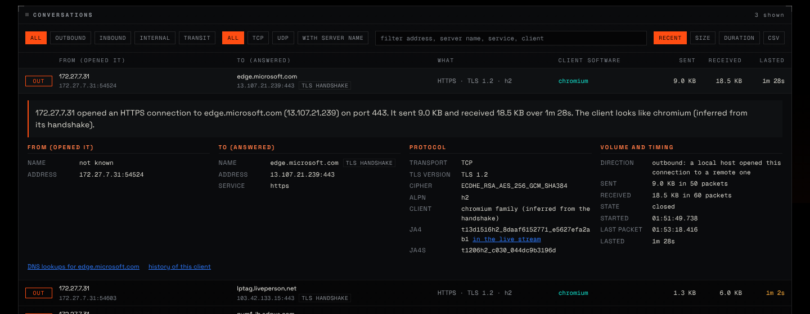
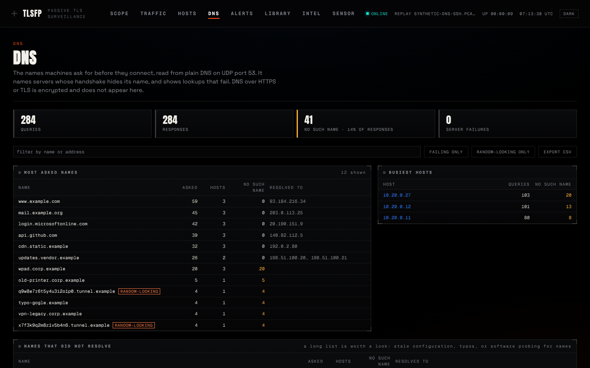
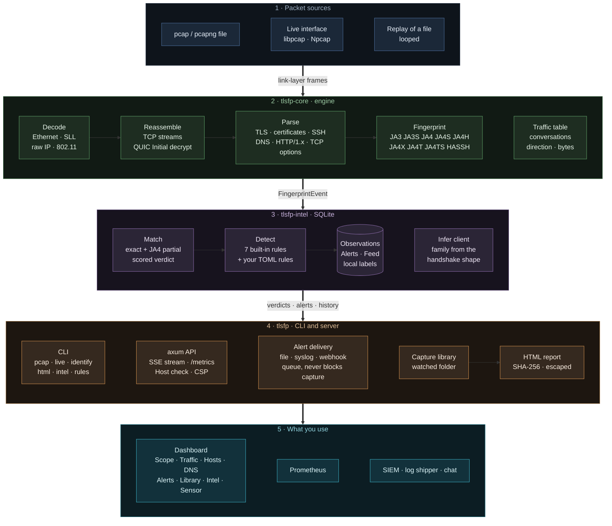

<div align="center">

# tlsfp

**Passive TLS, QUIC, SSH and DNS fingerprinting, with a live dashboard**

`tlsfp` watches a network interface or reads a packet capture and tells you, from the cleartext part of each connection, what software is on the other end. It computes **JA3 and the JA4+ family** for TLS and QUIC, **HASSH** for SSH, and reads plain **DNS**. It matches what it sees against threat intelligence and raises alerts when a client contradicts what it claims to be.

It never sends a packet and never decrypts anything.

[](https://github.com/TurlaFSB/JA3-JA4-TLS-FINGERPRINTING/actions/workflows/ci.yml)
[](https://github.com/TurlaFSB/JA3-JA4-TLS-FINGERPRINTING/releases)
[](LICENSE)
[](https://www.rust-lang.org)


[Install](#3-installation) · [First run](#4-first-run) · [Usage](#5-usage) · [Dashboard](#6-the-dashboard) · [Configuration](#7-configuration) · [Architecture](#9-architecture) · [FAQ](#13-faq-and-troubleshooting)

</div>


<sub>The dashboard replaying a vendored capture (`testdata/pcap/browsers-x509.pcapng`). Nothing on it is simulated.</sub>

---

## Contents

1. [Overview](#1-overview)
2. [Features](#2-features)
3. [Installation](#3-installation)
4. [First run](#4-first-run)
5. [Usage](#5-usage)
6. [The dashboard](#6-the-dashboard)
7. [Configuration](#7-configuration)
8. [Detection and intelligence](#8-detection-and-intelligence)
9. [Architecture](#9-architecture)
10. [Validation and performance](#10-validation-and-performance)
11. [Security and responsible use](#11-security-and-responsible-use)
12. [Limitations](#12-limitations)
13. [FAQ and troubleshooting](#13-faq-and-troubleshooting)
14. [Documentation](#14-documentation)
15. [Roadmap](#15-roadmap)
16. [Contributing, citation, licence, credits](#16-contributing-citation-licence-credits)

---

## 1. Overview

A TLS handshake starts in the clear. The ClientHello lists the protocol versions, cipher suites, extensions and curves a program supports, in an order that is characteristic of its TLS library and configuration. Hashing those choices gives a **fingerprint** that stays the same from one connection to the next and differs between a browser, `curl`, a Go service and a piece of malware. SSH does the same with its key-exchange offer, and DNS shows which names a machine asks for before it connects.

**Use it to**

- name the software behind a connection without reading its content;
- spot a "browser" whose handshake belongs to a script, or an operating-system claim its TCP stack contradicts;
- recognise known-malicious TLS stacks from public feeds, and notice when an address starts using a new client;
- see who is talking to whom: every conversation with both ends named (the domain, the address, the port), what it was, and how much moved;
- see which names a machine resolves, which DNS server it asked, and the lookups that fail;
- keep evidence: per-capture HTML reports carrying the file's SHA-256, JSON for pipelines, alerts to a SIEM.

**It is not**

- an attribution tool: a fingerprint identifies a software stack, not a person or a campaign;
- a decryptor or an intrusion-prevention system: it observes and reports;
- a replacement for Wireshark: there is no per-packet view and no payload.

| At a glance | |
|---|---|
| Fingerprints | JA3, JA3S, JA4, JA4S, JA4H, JA4X, JA4T, JA4TS (TLS, QUIC, HTTP, X.509, TCP) and HASSH / HASSHServer (SSH) |
| Also reads | plain DNS (queries, answers, failures) |
| Inputs | pcap and pcapng files; live capture on Linux, Windows and macOS |
| Outputs | text, JSON, HTML report, alerts to file / syslog / webhook, Prometheus, web dashboard, CSV and JSON exports |
| Built with | Rust (the engine forbids `unsafe`), SQLite, a React dashboard |
| Footprint | one binary and one database file; no daemon or external service |

## 2. Features

| Area | What you get |
|---|---|
| **Fingerprints** | JA3 / JA3S, JA4 / JA4S, JA4H (cleartext HTTP), JA4X (certificates), JA4T / JA4TS (TCP), HASSH / HASSHServer (SSH). GREASE stripped; raw and hashed forms. |
| **Handshake detail** | Every hello carries a readable account of what was offered or chosen: versions, cipher suites, extensions, groups, signature algorithms, ALPN, features (ECH, resumption, certificate compression and more). |
| **Transports** | TCP with full stream reassembly (reordering, retransmission, overlap); QUIC v1 and v2 (client Initial packets decrypted). |
| **Who talks to whom** | Every conversation is read as *from* (who opened it) *to* (who answered), with names where they can be known: the TLS handshake's server name, the HTTP Host, a DNS answer, a reverse lookup, and "this computer" for your own side. Each name says how it is known. The detail view adds TLS version and cipher, JA4 and JA4S, the client software, volume and timing, and a plain-English sentence. |
| **Who and where** | Every handshake is attributed to a site and a client (an exact feed match, or the family its shape suggests, with evidence and limits). |
| **DNS** | Plain DNS read from the wire: a generated summary of what is happening, the names asked, who asked and which DNS server answered (and how fast), reverse lookups decoded, names that failed, blocked names, and the connections that followed. A **worth a look** panel flags patterns (a host with many "no such name" answers, many random-looking subdomains under one domain, very long names, lookups at a steady rhythm, names that keep changing address), each with its evidence and what else could explain it. |
| **Detection** | Seven built-in rules over fingerprint history and cleartext HTTP, plus your own rules in a TOML file. |
| **Per-host history** | Which clients each address has run and when each first appeared. |
| **Capture health** | The sensor counts what it fails to read (kernel drops, shed conversations, clipped streams, handshakes that ended unread) and the dashboard says so, naming the flag that fixes it. |
| **Dashboard** | Scope, Traffic, Hosts, DNS, Alerts, Library, Intel and Sensor pages; detail drawer; light and dark; CSV and JSON export; time zone and text size. |
| **Delivery** | Alerts to a JSON-lines file, syslog (UDP or TCP) or a webhook; Prometheus `/metrics`. |
| **Operations** | Bounded memory, configurable limits, automatic retention, hardened HTTP server, release archives with checksums and build provenance. |

## 3. Installation

Pick the section for your system. Each is complete. Every step is a command you can paste; "expected" lines tell you what success looks like.

> **Which method?**
> - Windows or Linux and just want to run it → **prebuilt archive** (3.1 or 3.2).
> - macOS, or you want to build it → **from source** (3.3).
> - A demonstration, or analysing capture files only → **Docker** (3.4).

### 3.0 Platform support

| Platform | Status |
|---|---|
| Linux x86-64 | Built and tested in CI on every commit; released as an archive. |
| Windows 10 / 11 x86-64 | Built in CI on every commit; released as a zip. Reading captures needs nothing else. Live capture needs [Npcap](https://npcap.com). Observed working on one machine (2026-10-24); not covered by an automated test, because Npcap cannot be installed unattended in CI. |
| macOS | Same code path as Linux (libpcap). **Not built or tested in CI and not tested by the maintainer.** Expect it to work; please report problems. |
| Linux ARM64, BSD | Not built or tested. |

### 3.1 Windows (prebuilt zip)

**You need:** Windows 10 or 11 (64-bit) and, for live capture only, the free [Npcap](https://npcap.com) driver (about 1 MB; free for personal use, a licence is required to redistribute it commercially).

1. **Download** `tlsfp-VERSION-windows-x86_64.zip` and its `.sha256` file from the [latest release](https://github.com/TurlaFSB/JA3-JA4-TLS-FINGERPRINTING/releases/latest).
2. **Check the download** in PowerShell, in the folder you saved it to. The two values must be identical:
   ```powershell
   (Get-FileHash .\tlsfp-0.2.0-windows-x86_64.zip -Algorithm SHA256).Hash.ToLower()
   Get-Content .\tlsfp-0.2.0-windows-x86_64.zip.sha256
   ```
3. **Extract** it: right-click the zip, **Extract All…**, choose a folder such as `C:\tlsfp`.
4. **Install Npcap** (skip this if you only want to read capture files). Download it from <https://npcap.com>, run the installer and keep the default options. If you tick *"Restrict Npcap driver's access to Administrators only"*, you must run the terminal as Administrator later.
5. **Open PowerShell in the extracted folder.** In File Explorer, open the folder that contains `tlsfp.exe`, click the address bar, type `powershell` and press Enter.
6. **Start it:**
   ```powershell
   powershell -ExecutionPolicy Bypass -File .\start-windows.ps1
   ```
   *Expected:* it seeds the intelligence feed on the first run, prints `Dashboard: http://127.0.0.1:8080`, and opens your browser. Browse some websites in another window and conversations appear on the **Scope** and **Traffic** pages. Press `Ctrl+C` to stop.

To pick a particular adapter: `.\start-windows.ps1 -Interface "Wi-Fi"`. List adapters with `.\tlsfp.exe interfaces`.

Windows SmartScreen may warn about an unsigned download. The checksum and the build attestation (section 3.5) are how you confirm the file is the one the release workflow built; the program is not Authenticode-signed.

### 3.2 Linux (prebuilt archive)

**You need:** Linux x86-64 and `libpcap` (the runtime library).

```bash
# 1. Runtime library (Debian / Ubuntu shown; Fedora: sudo dnf install libpcap)
sudo apt-get install -y libpcap0.8

# 2. Download the archive and its checksum from the latest release page, then verify
sha256sum -c tlsfp-0.2.0-linux-x86_64.tar.gz.sha256          # expected: "...tar.gz: OK"

# 3. Extract and enter the folder
tar -xzf tlsfp-0.2.0-linux-x86_64.tar.gz
cd tlsfp-0.2.0-linux-x86_64

# 4. Load the bundled intelligence feed (offline, once)
./tlsfp intel seed                                            # expected: feed counts, 309 fingerprints in total

# 5. Allow live capture without running as root (once; repeat after replacing the binary)
sudo setcap cap_net_raw,cap_net_admin=eip ./tlsfp

# 6. Run it
./tlsfp serve --live auto                                     # open http://127.0.0.1:8080
```

The dashboard files (`web/`) are found beside the binary. To install system-wide: `sudo install -m 0755 tlsfp /usr/local/bin/tlsfp` and `mkdir -p ~/.local/share/tlsfp && cp -r web ~/.local/share/tlsfp/web`, then run `setcap` on `/usr/local/bin/tlsfp`.

Without `setcap`, capture needs `sudo ./tlsfp serve --live auto`. Reading capture files never needs a privilege.

### 3.3 From source (Linux, macOS, Windows)

**You need**

| Tool | Version | Why |
|---|---|---|
| Rust | 1.85 or newer ([rustup.rs](https://rustup.rs)) | compiles the sensor |
| libpcap headers | any recent | live capture (Windows: the Npcap SDK) |
| A C linker | | Linux `build-essential`; macOS Xcode tools; Windows MSVC Build Tools |
| Node.js and pnpm | 22 and 10 | builds the dashboard (optional: without it everything except the web UI works) |

**Linux and macOS**

```bash
# Dependencies
sudo apt-get install -y build-essential pkg-config libpcap-dev     # Debian / Ubuntu
#   Fedora: sudo dnf install -y gcc pkgconf-pkg-config libpcap-devel
#   macOS:  xcode-select --install
curl --proto '=https' --tlsv1.2 -sSf https://sh.rustup.rs | sh     # skip if Rust is installed
corepack enable                                                     # provides pnpm (Node 22 required)

# Build and install
git clone https://github.com/TurlaFSB/JA3-JA4-TLS-FINGERPRINTING.git
cd JA3-JA4-TLS-FINGERPRINTING
./install.sh --live
```

`install.sh` builds and installs `tlsfp` (to `~/.cargo/bin`, or `--prefix DIR`), seeds the feed, builds the dashboard into `~/.local/share/tlsfp/web`, and with `--live` grants the capture capabilities on Linux (asks for `sudo` once). Add `~/.cargo/bin` to your `PATH` if `tlsfp` is not found afterwards. On macOS, capture opens the BPF devices, which typically needs `sudo`.

**Windows**

1. Install Rust (MSVC toolchain) and the Visual Studio Build Tools with "Desktop development with C++".
2. Download the **Npcap SDK** (the SDK zip) from <https://npcap.com/#download>, extract it, and point `LIB` at its `Lib\x64` folder:
   ```powershell
   $env:LIB = "C:\npcap-sdk\Lib\x64"
   ```
3. Build:
   ```powershell
   git clone https://github.com/TurlaFSB/JA3-JA4-TLS-FINGERPRINTING.git
   cd JA3-JA4-TLS-FINGERPRINTING
   cargo build --release
   .\target\release\tlsfp.exe intel seed
   ```
4. Dashboard: install Node 22, run `corepack enable`, then `cd frontend; pnpm install --frozen-lockfile; pnpm build`.

The SDK is only needed to link; at run time the program loads Npcap on demand, so the same binary reads capture files on a machine without it.

### 3.4 Docker (demonstration and file analysis)

```bash
git clone https://github.com/TurlaFSB/JA3-JA4-TLS-FINGERPRINTING.git
cd JA3-JA4-TLS-FINGERPRINTING
docker compose --profile backend up --build
```

*Expected:* the dashboard at <http://127.0.0.1:11790>, populated from a replayed demo capture. Mount your own captures with `TLSFP_LIBRARY` (see `compose.yml`). A container on Windows or macOS cannot see the host's network card, so Docker is for demonstration and for analysing files, not live monitoring.

### 3.5 Verify what you downloaded

Every release archive has a `.sha256` file and a signed **build provenance attestation**: GitHub records that this exact file was built from this repository, at this commit, by the release workflow.

```bash
gh attestation verify tlsfp-0.2.0-linux-x86_64.tar.gz --repo TurlaFSB/JA3-JA4-TLS-FINGERPRINTING
```

### 3.6 Upgrade and uninstall

- **Upgrade:** replace the binary with the new archive's (or re-run `./install.sh`). The database migrates itself. On Linux, run `setcap` again after replacing the binary.
- **Uninstall:** delete the program folder, and the data folder to remove the database and dashboard: `~/.local/share/tlsfp` (Linux, macOS) or `%LOCALAPPDATA%\tlsfp` (Windows). `cargo uninstall tlsfp` removes a source install.

## 4. First run

Do these in order. Each step proves the one before it. The sample capture is a real recording of a Chromium browser, vendored from the FoxIO reference repository.

**Step 1. Get a sample capture** (a clone already has it at `testdata/pcap/`):

```bash
curl -LO https://raw.githubusercontent.com/TurlaFSB/JA3-JA4-TLS-FINGERPRINTING/main/testdata/pcap/browsers-x509.pcapng
```

**Step 2. Fingerprint it:**

```bash
tlsfp pcap browsers-x509.pcapng --intel        # from an extracted archive: ./tlsfp ... (Windows: .\tlsfp.exe ...)
```

*Expected:* one line per handshake. One reads:

```
… 172.27.7.31:54524 -> 13.107.21.239:443 client_hello ja4=t13d1516h2_8daaf6152771_e5627efa2ab1 ja3=34fcb8e0ef812f18e760b52314a54fd0 sni=edge.microsoft.com alpn=h2
    intel ja4=benign score=0.00 confidence=0.87 Google Chrome (tlsfp curated), Chromium 107.0.0, …
```

The `ja4` value is FoxIO's published reference fingerprint for this handshake. If you see it, the engine computes what the specification says.

**Step 3. Open the dashboard on the same file:**

```bash
tlsfp serve --replay browsers-x509.pcapng --loop
```

Browse to <http://127.0.0.1:8080>. The header reads `REPLAY …` and **Scope** fills within seconds. Click a row to open the detail drawer, then open **Traffic** and click a conversation to see who connected to whom ([how to read it](#how-to-read-a-conversation)).

**Step 4. Watch your own traffic** (needs the capture permission from section 3):

```bash
tlsfp interfaces            # shows what can be captured
tlsfp serve --live auto     # open http://127.0.0.1:8080, then browse the web in another window
```

The header now reads `LIVE …`. **Scope** shows handshakes, **Traffic** shows conversations and a capture health panel, **DNS** shows the names being asked for.

**Step 5. Know where things are:**

| What | Linux / macOS | Windows |
|---|---|---|
| Database (observations, alerts, labels) | `~/.local/share/tlsfp/intel.db` | `%LOCALAPPDATA%\tlsfp\intel.db` |
| Dashboard files | `web/` beside the program, or `~/.local/share/tlsfp/web` | `web\` beside `tlsfp.exe` |

Override the database with `--db PATH`.

## 5. Usage

The most common tasks. Every command, option and the HTTP API are in **[`docs/USAGE.md`](docs/USAGE.md)**.

```bash
# Analyse a file
tlsfp pcap capture.pcapng                      # one line per handshake
tlsfp pcap capture.pcapng --json               # one JSON object per event
tlsfp pcap capture.pcapng --intel --detect     # add verdicts, run the detection rules
tlsfp pcap capture.pcapng --report             # ranked forensic summary
tlsfp html capture.pcapng -o report.html       # self-contained report with the file's SHA-256
tlsfp identify captures/                       # which client is in each file of a folder

# Capture live
tlsfp interfaces                               # list what can be captured
tlsfp live auto --intel --detect               # the interface you actually use
tlsfp live eth0 --filter "tcp port 443"        # narrow the kernel filter
tlsfp live eth0 --buffer-mib 128 --max-flows 500000   # a busy link

# Dashboard and API
tlsfp serve --live auto                        # live, on http://127.0.0.1:8080
tlsfp serve --replay capture.pcapng --loop     # demonstration from a file
tlsfp serve --library ~/captures               # also identify the files in a folder

# Alerts and intelligence
tlsfp live eth0 --detect --alert-file alerts.jsonl --alert-syslog udp://siem:514
tlsfp intel lookup ja4 t13d1516h2_8daaf6152771_e5627efa2ab1
tlsfp intel label ja4 <value> --label "Brave on Windows"
```

Output is text or JSON (one object per line). A client hello, abridged:

```json
{"ts_nanos":1675707151805776000,"src":"192.168.1.168:50112","dst":"142.251.16.94:443","kind":"client_hello","ja3":"1c258ebef8eee2dfa3df6d8d07285af9","ja4":{"hash":"t13d1516h2_8daaf6152771_e5627efa2ab1","raw":"t13d1516h2_002f,0035,..."},"sni":"clientservices.googleapis.com","alpn":"h2","detail":{"versions":["TLS 1.3","TLS 1.2"],"ciphers":[{"id":4865,"name":"TLS_AES_128_GCM_SHA256"}],"…":"…"}}
```

**What each fingerprint is**

| Fingerprint | Computed from | Notes |
|---|---|---|
| **JA3 / JA3S** | ClientHello / ServerHello fields in wire order, MD5 | Unstable for clients that randomise extension order. Kept because public malware feeds use it. |
| **JA4** | ClientHello: transport, version, SNI, ALPN, sorted ciphers and extensions, truncated SHA-256 | Stable under extension shuffling. The primary fingerprint. |
| **JA4S** | ServerHello | Extensions in wire order. |
| **JA4H** | Cleartext HTTP/1.x request: method, version, header order, cookies, language | HTTP/2 and HTTPS requests are not visible to a passive observer. |
| **JA4X** | X.509 certificate issuer, subject and extension OIDs | Needs the certificate in the clear (TLS 1.2 and earlier). |
| **JA4T / JA4TS** | TCP SYN / SYN-ACK: window, options, MSS, window scale | Identifies the OS network stack beneath the TLS client. |
| **HASSH / HASSHServer** | SSH key-exchange offer: kex, cipher, MAC and compression lists, MD5 | Identifies the SSH library and configuration. Reported as an observation; not yet matched against a feed. |

```
t13d1516h2_8daaf6152771_e5627efa2ab1
│││ │ │  │  │            └─ SHA-256 (first 12 hex) of sorted extensions + signature algorithms
│││ │ │  │  └────────────── SHA-256 (first 12 hex) of sorted cipher suites
│││ │ │  └───────────────── first ALPN value (h2)
│││ │ └──────────────────── extension count (16)
│││ └────────────────────── cipher count (15)
││└──────────────────────── SNI present (d = domain, i = IP / absent)
│└───────────────────────── TLS version (13 = 1.3)
└────────────────────────── transport (t = TCP, q = QUIC)
```

Each fingerprint is pinned to published vectors in the test suite: [`learn/CONFORMANCE.md`](learn/CONFORMANCE.md).

## 6. The dashboard

`tlsfp serve` serves a web dashboard and a JSON API from one process. Every number on it comes from the sensor or the database; nothing is estimated, and a replayed capture says so in the header.

| Page | Purpose |
|---|---|
| **Scope** | Live handshakes with site, client and verdict; a By site view; a detail drawer for any event; CSV and JSON export of what is listed. |
| **Traffic** | Every conversation read left to right: who opened it (name and address), who answered (the domain, its address and port, and how the name is known: handshake, HTTP, DNS answer or reverse lookup), what it was (service, TLS version, ALPN, SSH banner), the client software, bytes each way and duration. Click a row for a plain-English sentence and every fact. Switch between **conversations** and **domains** (one row per domain: how many connections, how many machines, which addresses, how much data). A 15-minute throughput chart and the **capture health** panel sit above. See [how to read a conversation](#how-to-read-a-conversation). |
| **Hosts** | Per-machine history: which clients each address runs and when a new one appears. |
| **DNS** | A "what is happening" summary (always present, and when empty it says why), then the names being asked for, who asked, which DNS server they asked and how fast it answered, reverse lookups decoded to the address, names that failed, and the connections that followed each name. Plain-English explanations throughout. |
| **Alerts** | Every alert with a plain explanation and what to verify; filters and export. |
| **Library** | Capture files in a watched folder, identified and downloadable as HTML reports. |
| **Intel** | What this sensor has seen against what the feed knows; name unknown fingerprints yourself. |
| **Sensor** | How the sensor is set up, the interfaces it can capture, commands to change settings, display preferences (theme, time zone, text size), data downloads, shortcuts. |


### How to read a conversation

The **Traffic** page lists every conversation the sensor sees. Click a row to open it:



| Column | Meaning |
|---|---|
| **OUT / IN / LOCAL / PASSING** | Which way it crossed your network boundary: out (you opened it to the internet), in (something outside opened it to you), local (inside the network), passing (neither end is yours). |
| **From (opened it)** | The side that sent the first packet. Its name (your computer's name, or a reverse-DNS name) when known, then its address and port. |
| **To (answered)** | The server. Its **domain** when known, then its address and port, and a small tag saying how the name is known: `tls handshake` (the name the client asked for), `http request`, `dns answer` (a DNS response the sensor saw), or `reverse dns`. With no tag, only the address is known. |
| **What** | The service and what the handshake revealed, for example `HTTPS · TLS 1.2 · h2` or `SSH · OpenSSH_9.6`. |
| **Client software** | The software on the From side, from an exact match in the intelligence feed or inferred from the handshake's shape. |
| **Sent / received / lasted** | Bytes each way and how long the conversation ran. |

An address with no name is shown as an address because nothing on the wire names it: the handshake hid or omitted the name (Encrypted Client Hello, or not TLS), and no DNS answer or reverse lookup for it crossed the sensor. The sensor does not guess.

The **DNS** page works the same way for lookups. Start with the "what is happening" box, then click a name to see who asked, which DNS server answered, and the connections that followed.

<table>
<tr>
<td width="50%"></td>
<td width="50%"></td>
</tr>
<tr>
<td align="center"><sub>Traffic and capture health</sub></td>
<td align="center"><sub>DNS (from a synthetic capture, see <code>testdata/synthetic</code>)</sub></td>
</tr>
</table>

More, including every page and the detail drawer: [`docs/DASHBOARD.md`](docs/DASHBOARD.md).

## 7. Configuration

The sensor is passive. What you tune is how much of a busy link it reads and how it protects itself. Settings are fixed when the server starts; the dashboard's Sensor page shows them and gives the commands to change them.

| Setting | Flag | Environment variable | Default |
|---|---|---|---|
| Kernel filter | `--filter` | | `tcp or (udp and (port 443 or port 53))` |
| Promiscuous mode | `--no-promisc` to turn off | | on |
| Kernel capture buffer | `--buffer-mib` | `TLSFP_CAPTURE_BUFFER_MIB` | 32 |
| Conversations tracked | `--max-flows` | `TLSFP_MAX_FLOWS` | 65,536 |
| Idle timeout | `--idle-timeout` | `TLSFP_IDLE_TIMEOUT` | 60 s |
| Bytes read per stream | `--stream-limit-kib` | `TLSFP_STREAM_LIMIT_KIB` | 256 |
| NAT or proxy addresses | `--shared-network` | `TLSFP_SHARED_NETWORKS` | none |
| Extra "inside" networks | `--local-network` | `TLSFP_LOCAL_NETWORKS` | the interface's own |
| Retention | `--keep-days`, `--keep-alert-days`, `--max-observations` | | 90 d, 365 d, 5,000,000 |
| Alert destinations | `--alert-file`, `--alert-syslog`, `--alert-webhook`, `--alert-min-severity` | `TLSFP_ALERT_*` | none |
| Your own rules | `--rules FILE` | | none |
| Dashboard label | `--location TEXT` | `TLSFP_SENSOR_LOCATION` | none |

**Put it in a file.** Every option above can live in a `tlsfp.toml` instead of a long command line (`tlsfp config example > tlsfp.toml`, then `tlsfp --config tlsfp.toml serve`). Precedence, strongest first: flag, environment variable, file, default. A misspelt key is an error that lists the valid ones.

```toml
max-flows = 200000
alert-file = "alerts.jsonl"

[serve]
live = "auto"
buffer-mib = 64
```

**It keeps itself running.** If the capture's interface disappears (Wi-Fi switched off, a USB adapter unplugged), the sensor reopens it with growing pauses and the dashboard says `capture reconnecting` and why, instead of sitting online and silent. To run it as a service, with hardening, a reverse proxy, monitoring and backups: [`docs/DEPLOYMENT.md`](docs/DEPLOYMENT.md).

All settings and how to read the capture health panel: [`docs/CAPTURE_TUNING.md`](docs/CAPTURE_TUNING.md). Alert delivery: [`docs/ALERTS.md`](docs/ALERTS.md).

## 8. Detection and intelligence

Seven built-in rules, plus any you write, read fingerprint history stored in the database, so they behave identically on a replayed capture and a live link, and survive restarts.

| Rule | Fires when |
|---|---|
| `known_bad` | A fingerprint matches malicious or suspicious intelligence (once per source address). |
| `ua_mismatch` | A request claims a browser User-Agent but the TLS fingerprint belongs to a script or tool. |
| `os_mismatch` | The OS implied by the User-Agent disagrees with the one implied by the TCP SYN fingerprint. |
| `header_anomaly` | A "browser" sends headers browsers never send to that origin (impersonation tools on their defaults). |
| `first_seen` | A fingerprint never recorded before (informational). |
| `fp_rotation` | One address presents more than 5 distinct fingerprints in an hour. |
| `monoculture` | One fingerprint appears from more than 10 addresses in an hour. |
| `custom` | A rule from your own TOML file matched ([`docs/RULES.md`](docs/RULES.md)). |
| `dns_pattern` | A pattern in plain DNS traffic: a host with many "no such name" answers, many random-looking subdomains under one domain, or very long names. Raised once per host or domain, with the evidence and what else could explain it. |

The bundled feed has 309 fingerprints from four vendored sources (abuse.ch SSLBL, Salesforce's JA3 list, a curated set, and fingerprints measured from this project's own labelled captures). It is a baseline, not coverage of current malware. SSH is reported as an observation and is not yet matched against a feed. DNS patterns raise `dns_pattern` alerts, but individual DNS lookups are not matched against intelligence. Full semantics, sources and licences: [`docs/DETECTION.md`](docs/DETECTION.md); extending the feed: [`docs/INTELLIGENCE.md`](docs/INTELLIGENCE.md).

## 9. Architecture

Five layers, each handing one kind of thing to the next. Source: [`docs/architecture.mmd`](docs/architecture.mmd); renders for slides: [`docs/architecture.svg`](docs/architecture.svg), [`docs/architecture.png`](docs/architecture.png).



SSH and DNS enter at the engine layer (a banner sniff on TCP streams, a port-53 branch on UDP). They are observations: they reach the dashboard through the application layer and skip matching and detection, as noted in section 8.

| Layer | Crate | Owns | Does not |
|---|---|---|---|
| Engine | `tlsfp-core` | Decoding, TCP and QUIC reassembly, protocol parsing, every fingerprint algorithm, DNS and SSH reading, conversation accounting | Touch the network, a database or an async runtime. Forbids `unsafe`; treats every byte as hostile |
| Intelligence | `tlsfp-intel` | SQLite store, matching and scoring, client inference, detection rules, host history, labels, retention | Know where packets came from |
| Application | `tlsfp` | Reading files and interfaces, keeping the capture alive, the HTTP API and event stream, alert delivery, the capture library, reports, DNS summary and findings | Compute a fingerprint |
| Dashboard | `frontend/` | Showing it, with no logic the server cannot be asked for | Hold state that matters |

**Project layout**

```
crates/tlsfp-core/    engine: decode, reassemble, parse, fingerprint (no I/O, no unsafe)
crates/tlsfp-intel/   SQLite store: feeds, matching, detection, hosts, retention
crates/tlsfp/         the program: CLI, live capture, HTTP server, delivery, reports
frontend/             React dashboard
testdata/             real vendored captures (pcap/) and a synthetic one (synthetic/)
dataset/  eval/       labelled lab dataset and the reproducible evaluation
docs/  learn/         guides, and a learning path through the algorithms
install.sh  scripts/  installer, Windows start script, browser capture script
```

**Design decisions**

- **Parsers treat input as hostile:** bounds-checked readers; every malformed input is an error or a counted drop.
- **Synchronous core, async only at the edge:** the async runtime exists only in the web server.
- **QUIC needs no secret:** client Initial keys derive from the Destination Connection ID, which is sent in the clear (RFC 9001, RFC 9369).
- **Detection state lives in the database,** so history survives restarts and is bounded by retention.
- **Delivery never blocks capture:** alerts leave through a bounded queue and one worker; a slow destination drops and counts.
- **"Local" is learned, not guessed:** the capture interface's own networks define what is inside.
- **Honest about misses:** the engine counts what it fails to read, and the dashboard says so.

## 10. Validation and performance

| Check | Scope |
|---|---|
| Known-answer tests | JA3 (Salesforce vectors), JA4 (FoxIO vectors), QUIC key schedule (RFC 9001 and RFC 9369 appendices); HASSH recomputed outside the program |
| Integration tests | Vendored real captures in `testdata/pcap/` (provenance in `testdata/pcap/PROVENANCE.md`) |
| Property tests | Arbitrary and mutated bytes into every parser entry point; reassembly under arbitrary segmentation |
| CI on every commit | `cargo test` on stable and Rust 1.85, `clippy -D warnings`, `rustfmt`, `cargo audit`, `cargo deny`, a Windows build that starts and reads a capture without Npcap, frontend lint, types, tests and build, `pnpm audit`, reproducible evaluation |
| Security review | [`AUDIT.md`](AUDIT.md) |

**Evaluation** on a labelled lab dataset (428 handshakes from 22 known-good clients, 25 real Chrome builds, impersonation tools):

| Result | |
|---|---|
| Known-good clients given a suspicious or malicious verdict | 0 of 22 |
| Libraries claiming to be a browser, caught by `ua_mismatch` | 16 of 16, no false alarms on 8 honest libraries and 10 real browsers |
| Windows claims from a Linux host, caught by `os_mismatch` | 14 of 14 |
| Impersonation tools on default settings, caught by `header_anomaly` | 17 of 17 |
| Impersonation with defaults stripped and a Unix User-Agent | **Not caught by any rule** |
| Distinct fingerprints per client, JA3 against JA4 | 5.74 against 1.10 |

These are lab results; accuracy has not been quantified on real-world traffic. Method and limits: [`docs/EVALUATION.md`](docs/EVALUATION.md).

**Performance** (single core): fingerprinting alone about 90,000 TLS handshakes or 80,000 QUIC Initials per second; with matching and detection (SQLite) about 3,000 per second; live capture held about 1,200 new TLS connections per second with none missed on a shared 4-core machine. No figure exists for a physical high-speed interface. Methodology and caveats: [`docs/PERFORMANCE.md`](docs/PERFORMANCE.md).

Run the checks yourself:

```bash
cargo test --workspace
cargo clippy --workspace --all-targets -- -D warnings
cargo fmt --all --check
cd frontend && pnpm install && pnpm test && pnpm build
```

## 11. Security and responsible use

- **Capture rights:** on Linux grant `CAP_NET_RAW` and `CAP_NET_ADMIN` to the binary rather than running as root. On Windows install Npcap and run as yourself.
- **The dashboard and API have no authentication.** The server binds to `127.0.0.1` by default, and while bound to loopback it refuses any `Host` header that is not loopback or named with `--allowed-host`, which blocks DNS-rebinding pages. To share it, put it behind a reverse proxy that provides authentication and TLS.
- **Hardened responses:** strict Content-Security-Policy, `nosniff`, no-referrer; capped event streams; reports built one at a time; internal errors never reach the client; exported spreadsheets neutralise formula injection.
- **Webhook URLs are secrets:** supply them through the environment; only the host is ever logged.
- **What you collect is personal data:** the database, DNS summary and reports contain IP addresses, server names and queried names. Apply your retention and access controls; history is pruned automatically.
- **Monitor only networks you are authorised to monitor.** A fingerprint is a lead, not proof.

Vulnerability reports: [`SECURITY.md`](SECURITY.md) (GitHub private vulnerability reporting). Threat model: [`docs/THREAT_MODEL.md`](docs/THREAT_MODEL.md). Findings and fixes: [`AUDIT.md`](AUDIT.md).

## 12. Limitations

- **Fingerprints can be spoofed.** A tool that reproduces a browser's ClientHello (uTLS, curl-impersonate) is identical to it on the wire. The cross-layer rules raise the cost for tools on their defaults; they do not stop a careful attacker, and nothing here detects a real browser driven by automation.
- **A fingerprint names a stack, not a program.** The client label is an exact feed match or a family guessed from the handshake's shape; it cannot tell Brave from Chrome from Edge.
- **Encrypted Client Hello** hides the real server name and inner hello. DNS can still name the server when DNS is in the clear; otherwise the server stays an address.
- **No geolocation or ownership data:** the sensor shows addresses and names, not countries or companies, because it ships no GeoIP or ASN database.
- **Certificate names** are not shown: they are readable only on TLS 1.2 and earlier, and only the certificate's fingerprint (JA4X) is computed.
- **DNS** is seen only as plain UDP port 53. DNS over HTTPS or TLS is encrypted and invisible, and a local resolver on loopback is seen only if loopback is captured.
- **JA4X** needs the certificate in the clear (TLS 1.2 and earlier); **JA4H** covers cleartext HTTP/1.x only; **SSH** is read from the first key-exchange packet of each side only.
- **QUIC:** client Initial packets only; no 0-RTT, Handshake packets or connection migration.
- **Visibility:** it sees what the interface sees. On a switched network, watching other hosts needs a mirror port or tap. A capture point that sees one direction of a flow reads one direction.
- **Intelligence is a baseline** (309 fingerprints), drifting as client libraries change.
- **Platforms:** Windows live capture is verified by hand, not by CI; macOS is untested.
- **Accuracy** is measured on lab captures only.

## 13. FAQ and troubleshooting

**Does it send anything onto my network?** No. It opens the interface read-only and transmits nothing; it cannot be found by a scan.

**Does it decrypt HTTPS?** No. It reads only what is cleartext on the wire: the handshake, not the content.

**Will it work on a VPN, Wi-Fi, or inside WSL or a container?** On Wi-Fi and Ethernet, yes. Through a VPN it sees the tunnel's own handshake on the physical adapter, or the traffic inside it if you capture the VPN's virtual adapter. WSL and containers have their own virtual network; capture on the host interface for the host's traffic.

**Why is the client "Unrecognised"?** The fingerprint is not in the bundled feed. That means "not catalogued", not "bad". Name it yourself on the Intel page or with `tlsfp intel label`.

**Why does a server show only an address?** Nothing on the wire named it. See [how to read a conversation](#how-to-read-a-conversation). Browsers that use DNS over HTTPS or Encrypted Client Hello hide the names the sensor would otherwise read; turning off "secure DNS" in the browser, or watching the machine's own resolver, restores them.

**Why do I see nothing on Scope?** Check, in order: the header says `LIVE` (not `REPLAY` or `TAIL`); you have the capture permission; you chose the right interface (`tlsfp interfaces`, then `--live "<name>"`); on Windows, Npcap is installed. The Traffic page's capture health panel shows whether frames are arriving at all.

| Symptom | Cause and fix |
|---|---|
| `libpcap development files not found` while building | Install `libpcap-dev` (Debian/Ubuntu) or `libpcap-devel` (Fedora). |
| `error while loading shared libraries: libpcap.so.0.8` | Install `libpcap0.8` (the runtime library) when using the prebuilt Linux archive. |
| Permission denied when capturing on Linux | Run `sudo setcap cap_net_raw,cap_net_admin=eip ./tlsfp`, or use `sudo`. The grant is lost whenever the binary is replaced. |
| Windows: "Npcap is not installed" | Install Npcap with default options from npcap.com, then start again. Everything except live capture works without it. |
| Windows: "cannot open capture" although Npcap is installed | Npcap may be set to Administrators-only. Reinstall without that option, or run the terminal as Administrator. |
| Windows: no traffic appears | `tlsfp interfaces`, then `--live "Wi-Fi"` (part of the adapter's description works). `auto` skips VPN, VMware and Hyper-V adapters. |
| Log says `no dashboard files found`; port 8080 shows no page | Build the dashboard (`cd frontend && pnpm install && pnpm build`) or pass `--web DIR`. The release archives include it. |
| `421 Misdirected Request` | You used a host name the dashboard does not trust. Use `localhost` or `127.0.0.1`, or add `--allowed-host NAME`. |
| Handshakes seem to be missing | See the capture health panel on Traffic and [`docs/CAPTURE_TUNING.md`](docs/CAPTURE_TUNING.md). |
| `rustc 1.xx is too old` | `rustup update stable`; Rust 1.85 or newer is required. |

More: [`docs/INSTALL.md`](docs/INSTALL.md) and [`docs/LIVE_CAPTURE.md`](docs/LIVE_CAPTURE.md).

## 14. Documentation

| Topic | Document |
|---|---|
| Install, verify, troubleshoot (extended) | [`docs/INSTALL.md`](docs/INSTALL.md) |
| Every command and option, JSON fields, the HTTP API | [`docs/USAGE.md`](docs/USAGE.md) |
| Capture settings, health, output detail, accuracy limits | [`docs/CAPTURE_TUNING.md`](docs/CAPTURE_TUNING.md) |
| Running it as a service: config file, systemd, reverse proxy, monitoring, backups | [`docs/DEPLOYMENT.md`](docs/DEPLOYMENT.md) |
| Live capture and the Traffic page | [`docs/LIVE_CAPTURE.md`](docs/LIVE_CAPTURE.md) |
| Dashboard pages | [`docs/DASHBOARD.md`](docs/DASHBOARD.md) |
| Detection rules and the intelligence feed | [`docs/DETECTION.md`](docs/DETECTION.md), [`docs/RULES.md`](docs/RULES.md), [`docs/INTELLIGENCE.md`](docs/INTELLIGENCE.md) |
| Alert delivery (file, syslog, webhook) | [`docs/ALERTS.md`](docs/ALERTS.md) |
| Evaluation and dataset | [`docs/EVALUATION.md`](docs/EVALUATION.md), [`eval/README.md`](eval/README.md), [`dataset/README.md`](dataset/README.md) |
| Performance | [`docs/PERFORMANCE.md`](docs/PERFORMANCE.md) |
| Threat model and security audit | [`docs/THREAT_MODEL.md`](docs/THREAT_MODEL.md), [`AUDIT.md`](AUDIT.md) |
| How it works (learning path) | [`learn/02-ARCHITECTURE.md`](learn/02-ARCHITECTURE.md), [`learn/03-IMPLEMENTATION.md`](learn/03-IMPLEMENTATION.md), [`learn/ALGORITHMS.md`](learn/ALGORITHMS.md), [`learn/CONFORMANCE.md`](learn/CONFORMANCE.md) |
| Real browsers on Windows | [`docs/FIELD_OBSERVATIONS.md`](docs/FIELD_OBSERVATIONS.md), [`docs/BROWSER_CAPTURE.md`](docs/BROWSER_CAPTURE.md) |
| Releasing and changes | [`RELEASING.md`](RELEASING.md), [`CHANGES.md`](CHANGES.md) |

## 15. Roadmap

| Status | Item |
|---|---|
| Done | Security audit, CI, parser fuzz coverage, reproducible evaluation, lab-derived client intelligence |
| Done | Cleartext-HTTP rules evaluated on labelled scenarios, including adaptive attackers |
| Done | Per-host history, alert delivery, HTML reports, custom rules, Windows live capture, capture health |
| Done | SSH (HASSH) and plain DNS, with a DNS page and DNS-derived server names |
| Next | Optional offline GeoIP / ASN lookup to show country and network owner; certificate subject names on TLS 1.2 |
| Done | DNS pattern findings and `dns_pattern` alerts; a configuration file; automatic capture reconnection |
| Next | Match HASSH against a feed and add an SSH rule (for example a host whose SSH client changes) |
| Next | Real Firefox, Safari and Edge captures, and a second operating system, to replace impersonation stand-ins |
| Planned | A TLS-to-TCP consistency rule (needs real multi-OS captures to set a threshold) |
| Planned | Further passive protocols (DHCP and mDNS names, JA4L latency), and evasion and Encrypted Client Hello studies |

## 16. Contributing, citation, licence, credits

- Contributions: [`CONTRIBUTING.md`](CONTRIBUTING.md). Citation: [`CITATION.cff`](CITATION.cff). Security reports: [`SECURITY.md`](SECURITY.md).
- Licensed under the **GNU Affero General Public License v3.0** ([`LICENSE`](LICENSE)). A modified version run as a network service must offer its source to its users.

`tlsfp` is derived from [ja3-ja4-tls-fingerprinting](https://github.com/CarterPerez-dev/Cybersecurity-Projects/tree/main/PROJECTS/intermediate/ja3-ja4-tls-fingerprinting) by CarterPerez-dev (AngelaMos), AGPL-3.0, upstream commit `bf9ac5d`. The sensor core, fingerprint implementations, intelligence store and dashboard originate there; copyright headers are retained. Changes are listed in [`CHANGES.md`](CHANGES.md); provenance is in [`NOTICE.md`](NOTICE.md).

Fingerprint specifications: JA3 and JA3S by John Althouse, Jeff Atkinson and Josh Atkins (Salesforce, BSD-3-Clause); HASSH by Salesforce (BSD-3-Clause); JA4 by FoxIO (BSD-3-Clause). JA4S, JA4H, JA4X and JA4T are licensed by FoxIO under the FoxIO License 1.1 (non-commercial use, patent pending); see [`NOTICE.md`](NOTICE.md) before any commercial use. Threat feeds: abuse.ch SSLBL (CC0-1.0), Salesforce `osx-nix` (BSD-3-Clause), ja4db.com.
