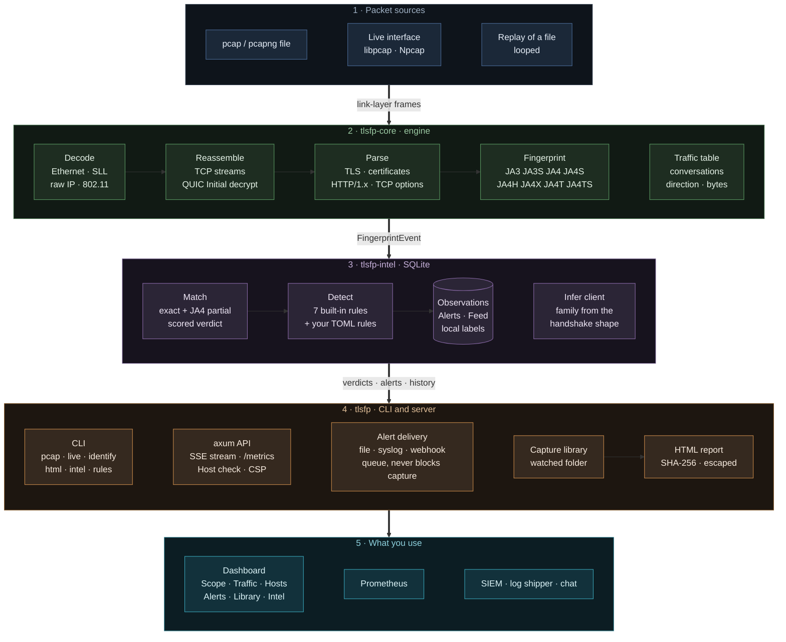

# tlsfp

Passive TLS fingerprinting for JA3 and the JA4+ family. Reads packet captures or a live interface, fingerprints every TLS handshake (including TLS carried in QUIC), matches fingerprints against threat intelligence, and raises alerts when a client's fingerprint contradicts what it claims to be.

[](https://github.com/TurlaFSB/JA3-JA4-TLS-FINGERPRINTING/actions/workflows/ci.yml)
[](LICENSE)
[](https://www.rust-lang.org)

`tlsfp` never transmits. It reads the cleartext part of the handshake, computes hashes of the client's and server's TLS choices, and compares them with what it knows. No decryption, no keys, no active probing.

## Contents

- [Capabilities](#capabilities)
- [Install](#install)
- [Usage](#usage)
- [Fingerprints](#fingerprints)
- [Detection](#detection)
- [Intelligence](#intelligence)
- [Output](#output)
- [Dashboard](#dashboard)
- [Architecture](#architecture)
- [Performance](#performance)
- [Validation](#validation)
- [Deployment and security](#deployment-and-security)
- [Limitations](#limitations)
- [Documentation](#documentation)
- [Roadmap](#roadmap)
- [Contributing, security reports, citation](#contributing-security-reports-citation)
- [License and acknowledgments](#license-and-acknowledgments)

## Capabilities

- **Fingerprints:** JA3, JA3S, JA4, JA4S, JA4H, JA4X, JA4T, JA4TS. GREASE values stripped; raw and hashed forms available.
- **Transports:** TCP with full stream reassembly (reordering, retransmission, overlap); QUIC v1 and v2 Initial packet decryption and CRYPTO-frame reassembly.
- **Inputs:** pcap and pcapng files; live capture on Linux, macOS and Windows (libpcap, or Npcap on Windows) with `--live auto` choosing the interface you actually use.
- **Matching:** exact lookup and JA4 prefix matching against a local SQLite database, scored into a verdict with confidence. Name fingerprints yourself with `tlsfp intel label`.
- **Detection:** seven built-in rules over fingerprint history and cleartext HTTP (known-bad, User-Agent mismatch, OS mismatch, header anomaly, first-seen, rotation, monoculture), plus rules you write in a TOML file.
- **Who and where:** every handshake is attributed to a site and to a client (an exact feed match, or the family its shape suggests, with the evidence and its limits); each address has a history of the clients it has run.
- **Output:** text and JSON, an HTML report per capture, alert delivery to a JSON-lines file, syslog or a webhook, Prometheus `/metrics`, and a web dashboard.
- **Resource bounds:** capped flow table, idle timeouts, per-stream byte limits, capped event streams, and retention of recorded history (90 days of observations, 365 of alerts and 5 million rows by default). The engine crate forbids `unsafe`.

## Install

**Linux and macOS.** Requirements: Rust 1.85 or newer, libpcap development files (`apt-get install libpcap-dev`, `brew install libpcap`) and, for the dashboard, pnpm.

```bash
git clone https://github.com/TurlaFSB/JA3-JA4-TLS-FINGERPRINTING.git
cd JA3-JA4-TLS-FINGERPRINTING
./install.sh --live          # builds the program and the dashboard, seeds the feed, grants capture rights
tlsfp serve --live auto      # dashboard on http://127.0.0.1:8080, capturing the interface you use
```

`./install.sh` without `--live` skips the capability grant (capture then needs sudo). To build without installing: `cargo build --release`, then `tlsfp intel seed`.

**Prebuilt archives.** Each [release](https://github.com/TurlaFSB/JA3-JA4-TLS-FINGERPRINTING/releases) carries a Linux x86-64 tarball and a Windows x86-64 zip, each with a `.sha256` file and a build provenance attestation. Verify before running:

```bash
sha256sum -c tlsfp-0.2.0-linux-x86_64.tar.gz.sha256
gh attestation verify tlsfp-0.2.0-linux-x86_64.tar.gz --repo TurlaFSB/JA3-JA4-TLS-FINGERPRINTING
```

**Windows.** Install [Npcap](https://npcap.com) once (about 1 MB; free for personal use), download the Windows zip from the release, extract it and run `.\start-windows.ps1`. Reading capture files, the Library page and reports work without Npcap. Details and the manual test checklist: [`docs/LIVE_CAPTURE.md`](docs/LIVE_CAPTURE.md).

**Container.** `docker compose --profile backend up` serves the dashboard (host port 11790) with a replayed demo capture. A container cannot see the host's network card on Windows or macOS, so it replays a file; use a native install for live traffic. See `compose.yml`.

## Usage

```bash
tlsfp pcap capture.pcapng                    # one line per handshake
tlsfp pcap capture.pcapng --json             # one JSON object per event
tlsfp pcap capture.pcapng --intel --detect   # match and run detection rules
tlsfp pcap capture.pcapng --report           # ranked forensic summary

tlsfp live auto --intel --detect             # live capture on the interface you use (or name one: eth0, "Wi-Fi")
tlsfp live eth0 --filter "tcp port 443"      # narrow the kernel BPF filter

tlsfp html capture.pcapng -o report.html     # one self-contained HTML report with the file's SHA-256
tlsfp rules check my-rules.toml              # validate your detection rules (--rules FILE to use them)
tlsfp live eth0 --detect --alert-file alerts.jsonl --alert-syslog udp://siem:514   # forward alerts
tlsfp interfaces                             # what live capture can use
tlsfp identify captures/                     # which client is in each capture file
tlsfp intel seed                             # load bundled feeds
tlsfp intel import ja4db.json                # import a ja4db.com export (validated per record)
tlsfp intel lookup ja4 t13d1516h2_8daaf6152771_e5627efa2ab1
tlsfp intel label ja4 <value> --label "Brave on Windows"   # name a fingerprint yourself (labels, unlabel)
tlsfp intel alerts                           # recent alerts
tlsfp intel prune --keep-days 30             # delete old history now (serve does it every 15 minutes; --keep-days, --keep-alert-days, --max-observations, 0 keeps all)

tlsfp serve 127.0.0.1:8080                   # API and dashboard, tails the database
tlsfp serve --replay capture.pcapng --loop   # dashboard fed from a replayed capture
tlsfp serve --live eth0                      # dashboard fed from a live interface
tlsfp serve --library ~/tlsfp-captures       # also list and identify the capture files in a folder
tlsfp serve --location "DC-2 rack 14"        # label shown in the dashboard header (or TLSFP_SENSOR_LOCATION)
tlsfp serve --local-network 203.0.113.0/24   # networks that count as "inside" besides the interface's own (or TLSFP_LOCAL_NETWORKS)
tlsfp serve --allowed-host dash.lan          # another name the dashboard may be reached by (loopback binds check the Host header)
tlsfp pcap x.pcap --detect --shared-network 10.0.0.0/8   # NAT or proxy addresses (or TLSFP_SHARED_NETWORKS)
```

Live capture needs raw-socket capabilities. Grant them to the binary instead of running as root:

```bash
sudo setcap cap_net_raw,cap_net_admin=eip "$(command -v tlsfp)"
```

The default database is `~/.local/share/tlsfp/intel.db`; override with `--db`.

## Fingerprints

| Fingerprint | Computed from | Notes |
|---|---|---|
| JA3 / JA3S | ClientHello / ServerHello fields in wire order, MD5 | Unstable for clients that randomize extension order. Kept because public malware feeds use it. |
| JA4 | ClientHello: transport, version, SNI, ALPN, sorted cipher and extension lists, SHA-256 truncated | Stable under extension shuffling. Primary fingerprint. |
| JA4S | ServerHello | Extensions in wire order. |
| JA4H | Cleartext HTTP/1.x request: method, version, header order, cookies, language | HTTP/2 and HTTPS requests are not visible to a passive observer. |
| JA4X | X.509 certificate issuer, subject and extension OIDs | Visible only where the certificate is in the clear (TLS 1.2 and earlier). |
| JA4T / JA4TS | TCP SYN / SYN-ACK: window size, options, MSS, window scale | Identifies the OS network stack beneath the TLS client. |

Anatomy of a JA4 value:

```
t13d1516h2_8daaf6152771_e5627efa2ab1
│││ │ │  │  │            └─ SHA-256 (first 12 hex) of sorted extensions + signature algorithms
│││ │ │  │  └────────────── SHA-256 (first 12 hex) of sorted cipher suites
│││ │ │  └───────────────── first ALPN value (h2)
│││ │ └──────────────────── extension count (16)
│││ └────────────────────── cipher count (15)
││└──────────────────────── SNI present (d = domain, i = IP / absent)
│└───────────────────────── TLS version (13 = 1.3)
└────────────────────────── transport (t = TCP, q = QUIC)
```

The exact published vector each fingerprint is tested against, and every deliberate scope boundary, is in [`learn/CONFORMANCE.md`](learn/CONFORMANCE.md).

## Detection

Rules read fingerprint history stored in the database, so they behave identically on a capture replayed at once and on a live link, and state survives restarts.

| Rule | Fires when |
|---|---|
| `known_bad` | A fingerprint matches malicious or suspicious intelligence. Raised once per source address, so a beacon is one alert, not one per flow. |
| `ua_mismatch` | A cleartext request presents a browser User-Agent while the same client's TLS fingerprint belongs to a script or tool. |
| `os_mismatch` | The OS implied by the User-Agent disagrees with the OS implied by the client's TCP SYN fingerprint (JA4T). |
| `first_seen` | The fingerprint has never been recorded before. Informational. |
| `fp_rotation` | One address presents more than 5 distinct fingerprints within the window (default 1 hour). |
| `monoculture` | One fingerprint appears from more than 10 distinct addresses within the window. Never raised for a fingerprint with an exact benign match. |
| `custom` | A rule from your own TOML file matched: server names, fingerprints, client families, verdicts, networks, ports, TLS version, extensions. [`docs/RULES.md`](docs/RULES.md) |
| `header_anomaly` | A cleartext request claiming a browser carries headers browsers never send to that origin: `Sec-Fetch-*`, `Sec-CH-*` Client Hints, or an `Upgrade: h2c` / `HTTP2-Settings` handshake. Skips loopback origins. Catches impersonation tools left on their defaults; trivially evaded. |

Thresholds and the window are configurable in `DetectConfig`. Defaults suit a quiet link; busy sensors should raise them. Rotation and monoculture are skipped for addresses declared with `--shared-network` (a NAT gateway, proxy or jump host).

## Intelligence

| Source | Records | Category | Licence |
|---|---|---|---|
| abuse.ch SSLBL | 97 | malware, C2 | CC0-1.0 |
| Salesforce `osx-nix` JA3 list | 157 | benign applications | BSD-3-Clause |
| Curated set | 21 | C2, tools, field-observed Firefox 158 | project |
| Lab-derived clients (`tlsfp lab`) | 34 | benign libraries and real Chromium builds | AGPL-3.0-only |
| ja4db.com (optional import) | variable | mixed | see ja4db.com terms |

Feeds are vendored and compiled into the binary, so seeding needs no network. Benign and malicious sources are both loaded on purpose: some hashes appear in both, and the matcher scores the disagreement.

The `tlsfp lab` feed is generated from the project's own labeled captures of real client builds (curl, Python, Go, Java, Ruby, PHP and Chromium 107 to 143); see [`dataset/README.md`](dataset/README.md). Verdict rules: a *benign* verdict needs an exact match, a partial match (same cipher list) is only a similarity hint, and only the strongest match tier votes.

## Output

Text:

```
1675707151.805 192.168.1.168:50112 -> 142.251.16.94:443 client_hello ja4=t13d1516h2_8daaf6152771_e5627efa2ab1 ja3=1c258ebef8eee2dfa3df6d8d07285af9 sni=clientservices.googleapis.com alpn=h2
    intel ja4=benign score=0.00 confidence=0.80 Google Chrome (tlsfp curated)
```

JSON (`--json`), one object per line:

```json
{"ts_nanos":1675707151805776000,"src":"192.168.1.168:50112","dst":"142.251.16.94:443","kind":"client_hello","ja3":"1c258ebef8eee2dfa3df6d8d07285af9","ja4":{"hash":"t13d1516h2_8daaf6152771_e5627efa2ab1","raw":"t13d1516h2_002f,0035,..."},"sni":"clientservices.googleapis.com","alpn":"h2"}
```

Forensic report (`--report`) summarizes a whole capture: frame and flow counts, fingerprints by kind, top client JA4 values, top server names, and per-endpoint fingerprints, verdicts and alerts.

## Dashboard

`tlsfp serve` serves a web dashboard and a JSON API from one process. Every number on it comes from the sensor or the database; nothing is estimated or invented, and a replayed capture says so in the header.

| Page | What it answers |
|---|---|
| **Scope** | What is crossing the sensor now. Each handshake row names the **site** and the **client**; a server's reply borrows the site from its connection. The **By site** view lists each site with the clients and fingerprints that reached it. Click any row for a side drawer: a plain sentence about the event, connection facts, who the client is and why, every fingerprint with a one-line explanation and copy button, the JA4 breakdown, the other events of the same connection, intelligence, alerts with what each rule means, and shortcuts to filter or open the host's history (Esc closes, up and down step). Profiles group the live window by fingerprint or destination and compare two fingerprints side by side. |
| **Traffic** | Every conversation with bytes and packets each way, direction, server name and client, a 15-minute throughput chart kept on the server (full when you open the page), and top remote hosts. "Local" means the capture interface's own networks plus private ranges plus `--local-network`. `/metrics` exposes Prometheus counters. |
| **Hosts** | One profile per machine: which client fingerprints it runs and when each first appeared, the servers it talks to, User-Agent and OS claims, and its alerts. A host that starts presenting a new client is the thing to look at. Servers that only answered are listed separately. |
| **Alerts** | Every alert with severity and rule filters, search, a plain explanation of each rule and what to verify, export, and a link to the host. |
| **Library** | Capture files found in a watched folder (`--library DIR`), each read once, named, and downloadable as an HTML report. |
| **Intel** | What this sensor has seen set against what the feed knows: the share of connections the feed can name, the fingerprints it cannot (with the shape-based guess and the exact command to name them), then the catalogue, feeds and licences. |

- **Opens populated:** the server keeps the last 500 events and sends them in one piece on connect; a replayed capture is loaded at full speed on its first pass.
- **Themes:** dark and light. `/` focuses the stream filter.
- **Header:** backend reachability, the active feed (live interface, replayed capture or database tail), uptime and the operator's `--location` label.
- **API:** `/api/stats`, `/api/alerts`, `/api/search`, `/api/export`, `/api/observed`, `/api/hosts`, `/api/hosts/{ip}`, `/api/traffic`, `/api/library`, `/api/library/{id}/report`, `/api/meta` (no filesystem paths), `/api/health`, `/api/stream` (Server-Sent Events, capped at 64 open streams) and `/metrics`. Errors never carry internal detail.

Build the frontend once with `cd frontend && pnpm install && pnpm build`; `tlsfp serve` finds `frontend/dist`, or the `web` folder beside the program or the database. The Docker setup builds it for you.

## Architecture

Five layers, each handing one kind of thing to the next. The source of this diagram is [`docs/architecture.mmd`](docs/architecture.mmd); a rendered copy for slides is [`docs/architecture.svg`](docs/architecture.svg) and [`docs/architecture.png`](docs/architecture.png).



| Layer | Crate | Owns | Does not |
|---|---|---|---|
| Engine | `tlsfp-core` | Decoding, TCP and QUIC reassembly, protocol parsing, every fingerprint algorithm, conversation accounting | Touch the network, a file's meaning, a database or an async runtime. It forbids `unsafe` and treats every byte as hostile |
| Intelligence | `tlsfp-intel` | The SQLite store, matching and scoring, client inference, detection rules, host history, operator labels, retention | Know where packets came from |
| Application | `tlsfp` | Reading files and interfaces, the HTTP API and event stream, alert delivery, the capture library, reports | Compute a fingerprint |
| Dashboard | `frontend/` | Showing it, with no logic the server cannot be asked for | Hold state that matters |

Design decisions:

- **Parsers treat input as hostile.** The engine forbids `unsafe`, readers are bounds-checked, and every malformed input is an error or a counted drop.
- **Synchronous core, async only at the edge.** A lookup is one indexed query and a capture is a plain loop; the async runtime exists only in the web server.
- **QUIC needs no secret.** Client Initial keys derive from the Destination Connection ID, which is sent in the clear (RFC 9001, RFC 9369).
- **Detection state lives in the database,** not in memory, so a sensor keeps its history across restarts and external writers can share it. Retention keeps it bounded.
- **Delivery never blocks capture.** Alerts reach files, syslog and webhooks through a bounded queue and one worker thread; a slow destination drops and counts, it does not stall packets.
- **"Local" is learned, not guessed.** The Traffic page takes the capture interface's own networks as inside, so a host with a public address sees its own traffic as its own.
- **Windows is a first-class target.** The capture library is delay-loaded, so file analysis runs without Npcap, and the same codebase builds for Linux, macOS and Windows.

## Performance

Single core (live capture tested to about 1,200 new TLS connections a second with no handshake missed, on a shared 4-core machine; no figure exists for a physical interface): fingerprinting alone runs at about 90,000 TLS handshakes or 80,000 QUIC Initials per second; with intelligence matching and detection (SQLite) about 3,000 per second. Methodology, caveats and what has not been measured: [`docs/PERFORMANCE.md`](docs/PERFORMANCE.md).

## Validation

| Check | Scope |
|---|---|
| Known-answer tests | JA3 (Salesforce vectors), JA4 (FoxIO vectors), QUIC key schedule (RFC 9001 and RFC 9369 appendices) |
| Integration tests | Vendored captures in `testdata/pcap/` (provenance in `testdata/pcap/PROVENANCE.md`) |
| Property tests | Arbitrary and mutated bytes into the TLS, QUIC, HTTP, SSLv2, certificate and pipeline entry points; stream reassembly under arbitrary segmentation |
| CI | `cargo test` on stable and Rust 1.85, `clippy -D warnings`, `rustfmt`, `cargo audit`, `cargo deny` (licences, bans, advisories), a Windows build that starts and reads a capture without Npcap, frontend lint, types, tests and build, evaluation reproducibility |
| Security review | [`AUDIT.md`](AUDIT.md) |

Run locally:

```bash
cargo test --workspace
cargo clippy --workspace --all-targets -- -D warnings
cargo fmt --all --check
cargo audit
cargo deny check
cargo bench -p tlsfp-core        # throughput benchmarks
```

### Evaluation

`dataset/` holds labeled handshakes from real client builds, curl-impersonate browser profiles and real Chromium builds from version 107 to 143; `eval/` measures fingerprint stability, impersonation fidelity and what the sensor concludes about each client. Everything is reproducible and verified in CI.

| Measured result | |
|---|---|
| Known-good clients receiving a suspicious or malicious verdict | 0 of 22 (428 handshakes) |
| Known-good clients unseen by the feed that were wrongly vouched for | 0 of 5 (reported unknown) |
| Real Chromium headless-shell builds whose JA4 equals the nearest-version curl-impersonate profile | 8 of 9 |
| Real full Chrome builds (25, versions 118 to 143) whose JA4 equals it | 0 of 25: the profiles send ECH, the lab Chrome does not |
| Distinct JA4 families across 25 real full Chrome builds | 3, plus a resumption variant of each |
| Lying libraries caught by `ua_mismatch` (a library claiming Chrome or Safari) | 16 of 16, no false alarms on 8 honest libraries and 10 real browsers |
| Windows claims from a Linux host caught by `os_mismatch` | 14 of 14 |
| Impersonation tools left on defaults caught by `header_anomaly` | 17 of 17, no false alarms |
| Impersonation with defaults stripped and a Unix User-Agent | **not caught by any rule** |
| JA4 sets reproducing across two lab runs | 28 of 28 clients |
| Distinct fingerprints per client, JA3 against JA4 | 5.74 against 1.10 |

JA3 changes on every connection for any client that randomizes extension order, while JA4 collapses them. Impersonation is where the evaluation changed the most. Against Chromium headless shells the curl-impersonate profile is byte-identical (8 of 9); against full Chrome in the lab it never is (0 of 25), because the profiles send ECH, use a stale ALPS codepoint for Chrome 127 to 131 and lack the trust-anchors extension of Chrome 141 and later. Chrome's ClientHello depends on build flavour and configuration, and the lab could not make Chrome send ECH (feature flag, secure DNS and a non-loopback address all failed), so whether a profile separates from a typical desktop user is not something the lab can settle. The sensor therefore never lists impersonation profiles as tools, because the opposite error would flag real users, and it catches impersonation at other layers: curl-impersonate sends Client Hints, `Sec-Fetch-*` headers and an h2c upgrade over cleartext, which real browsers never do, so `header_anomaly` catches the default configuration. An attacker who removes those headers and claims a Unix User-Agent evades every rule here, and real-browser automation looks like a user at every measured layer. The evaluation also led to fixes in the matcher and label logic and to the `--shared-network` option for NAT gateways. Method, results and limits: [`eval/README.md`](eval/README.md); clients and threats to validity: [`dataset/README.md`](dataset/README.md).

## Deployment and security

- Run live capture with `CAP_NET_RAW` and `CAP_NET_ADMIN` only, never as root (`install.sh --live` grants exactly these). On Windows install Npcap and run as yourself.
- The HTTP API and dashboard have **no authentication**. The default bind is `127.0.0.1`, and while it is bound to a loopback address the server refuses any request whose `Host` is not `localhost` or a loopback address (or named with `--allowed-host`), which stops a web page from reading it through DNS rebinding. If the dashboard must be reachable by others, put it behind a reverse proxy that provides authentication and TLS.
- Responses carry a strict Content-Security-Policy (own scripts and styles only, no framing), `nosniff` and no-referrer. Data is never cached; the app is revalidated on every load.
- Event streams are capped, reports are built one at a time, and a 500 never reveals an internal message.
- Alert webhooks are sent as you configure them. The URL is usually a secret: use the environment variable, and only its host is ever logged. Delivery is at most once ([`docs/ALERTS.md`](docs/ALERTS.md)).
- The database is bounded: observations and alerts older than the retention window, and rows beyond the cap, are deleted oldest first (ages count back from the newest record, so a replayed old capture is safe). After the window a returning fingerprint is "first seen" again.
- Capture files and database contents include IP addresses and SNI values, which can be personal data. Apply your retention and access controls. Reports contain the capture's file name and SHA-256, addresses and server names.
- A fingerprint identifies a TLS implementation and configuration, not a person. Treat `known_bad` as a lead, not proof.

Threat model, assumptions and responsible use: [`docs/THREAT_MODEL.md`](docs/THREAT_MODEL.md). Findings and fixes: [`AUDIT.md`](AUDIT.md).

## Limitations

- Fingerprints can be spoofed (uTLS, curl-impersonate, custom ClientHello), and a spoofed ClientHello is identical to the real one. The cross-layer rules raise the cost for tools on their defaults; they do not stop a careful attacker, and nothing here detects a real browser driven by automation.
- Encrypted Client Hello hides the inner ClientHello; detection degrades to the outer one.
- JA4X needs the certificate in the clear (TLS 1.2 and earlier). JA4H covers cleartext HTTP/1.x only.
- QUIC support covers client Initial packets; no 0-RTT, Handshake packets, or connection migration.
- The bundled intelligence (309 fingerprints) is a baseline, not coverage of current malware. Its client entries come from one Linux host (plus Firefox 158 from one Windows machine) and drift as client libraries change. [`docs/INTELLIGENCE.md`](docs/INTELLIGENCE.md) explains how to import ja4db.com and add your own.
- A tool that reproduces a real browser's ClientHello cannot be separated from it by JA3 or JA4, and whether curl-impersonate does depends on browser configuration the sensor cannot see (see the fidelity results in [`eval/README.md`](eval/README.md)). Curated browser fingerprints are families, not single values: 25 real Chrome builds produced three.
- Live capture on Windows is verified by hand on a real machine ([`RELEASING.md`](RELEASING.md)): CI cannot install Npcap unattended, so it builds the program and checks that it starts, reads captures and fails clearly without Npcap, but does not capture.
- The dashboard's "client" for a handshake is an exact feed match or a family guessed from the handshake's shape (Chromium, Firefox, ...). It cannot tell Brave from Chrome from Edge, and a tool that copies a browser's handshake gets the browser's name.
- Accuracy is measured on lab captures only (see Validation); it has not been quantified on real-world traffic.

## Documentation

| Document | Contents |
|---|---|
| [`learn/02-ARCHITECTURE.md`](learn/02-ARCHITECTURE.md) | Crate structure, pipeline, intelligence store |
| [`learn/03-IMPLEMENTATION.md`](learn/03-IMPLEMENTATION.md) | Code walkthrough from frame to alert |
| [`learn/ALGORITHMS.md`](learn/ALGORITHMS.md) | Byte-level definition of each fingerprint and QUIC decryption |
| [`learn/CONFORMANCE.md`](learn/CONFORMANCE.md) | Published vectors and scope boundaries |
| [`docs/THREAT_MODEL.md`](docs/THREAT_MODEL.md) | Threat model and responsible use |
| [`AUDIT.md`](AUDIT.md) | Security audit findings |
| [`eval/README.md`](eval/README.md) | Evaluation method and results |
| [`docs/FIELD_OBSERVATIONS.md`](docs/FIELD_OBSERVATIONS.md) | Fingerprints of real Brave, Edge and Firefox on Windows |
| [`docs/BROWSER_CAPTURE.md`](docs/BROWSER_CAPTURE.md) | Capture a real desktop browser and replay it in the dashboard |
| [`docs/RULES.md`](docs/RULES.md) | Writing your own detection rules |
| [`docs/ALERTS.md`](docs/ALERTS.md) | Sending alerts to a file, syslog or a webhook |
| [`docs/LIVE_CAPTURE.md`](docs/LIVE_CAPTURE.md) | Live capture, the Traffic page and their limits |
| [`docs/PERFORMANCE.md`](docs/PERFORMANCE.md) | Measured throughput and its limits |
| [`docs/INTELLIGENCE.md`](docs/INTELLIGENCE.md) | Extending the intelligence feed; licensing |
| [`dataset/README.md`](dataset/README.md) | Dataset construction and validity |
| [`RELEASING.md`](RELEASING.md) | Release and signed-tag procedure |
| [`CHANGES.md`](CHANGES.md) | Changes relative to the upstream base |

## Roadmap

| Status | Item |
|---|---|
| Done | Security audit, CI, parser fuzz coverage, reproducible fingerprint and detection evaluation, lab-derived client intelligence |
| Next | Real Firefox, Safari and Edge captures, and a second operating system, to replace impersonation stand-ins |
| Done | Cleartext-HTTP rules (`ua_mismatch`, `os_mismatch`, `header_anomaly`) evaluated on labeled scenarios, including adaptive attackers |
| Next | Real desktop Chrome, Firefox and Safari on more than one operating system; with only one browser family a learned classifier would learn the browser, not the impersonation |
| Done | Per-host history: which clients each address runs and when each first appeared (the Hosts page). A rule that alerts on the change itself is still planned |
| Planned | A TLS-to-TCP consistency rule: a browser ClientHello arriving from a TCP SYN fingerprint of the wrong operating system. Needs real captures of the same browsers on several systems; one Windows machine is not enough to set a threshold |
| Planned | Evasion study (uTLS, curl-impersonate) and Encrypted Client Hello impact |

## Contributing, security reports, citation

- Contributions: [`CONTRIBUTING.md`](CONTRIBUTING.md)
- Vulnerability reports: [`SECURITY.md`](SECURITY.md), via GitHub private vulnerability reporting
- Citation: [`CITATION.cff`](CITATION.cff)

## License and acknowledgments

Licensed under the GNU Affero General Public License v3.0 ([`LICENSE`](LICENSE)). A modified version run as a network service must offer its source to its users.

`tlsfp` is derived from [ja3-ja4-tls-fingerprinting](https://github.com/CarterPerez-dev/Cybersecurity-Projects/tree/main/PROJECTS/intermediate/ja3-ja4-tls-fingerprinting) by CarterPerez-dev (AngelaMos), AGPL-3.0, upstream commit `bf9ac5d`. The sensor core, fingerprint implementations, intelligence store and dashboard originate there; copyright headers are retained. Changes are listed in [`CHANGES.md`](CHANGES.md); full provenance is in [`NOTICE.md`](NOTICE.md).

Fingerprint specifications: JA3 and JA3S by John Althouse, Jeff Atkinson and Josh Atkins (Salesforce, BSD-3-Clause); JA4 by FoxIO (BSD-3-Clause). JA4S, JA4H, JA4X and JA4T are licensed by FoxIO under the FoxIO License 1.1 (non-commercial use, patent pending); see [`NOTICE.md`](NOTICE.md) before any commercial use. Threat feeds: abuse.ch SSLBL (CC0-1.0), Salesforce `osx-nix` (BSD-3-Clause), ja4db.com.
