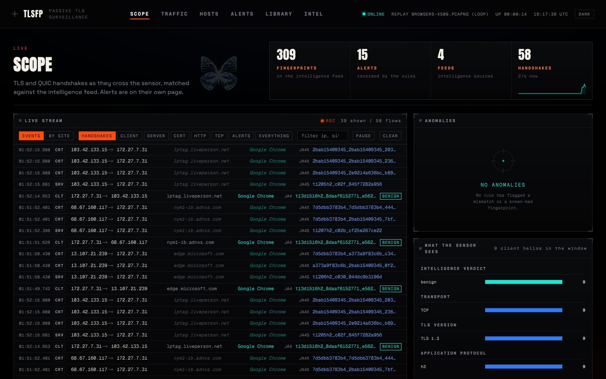
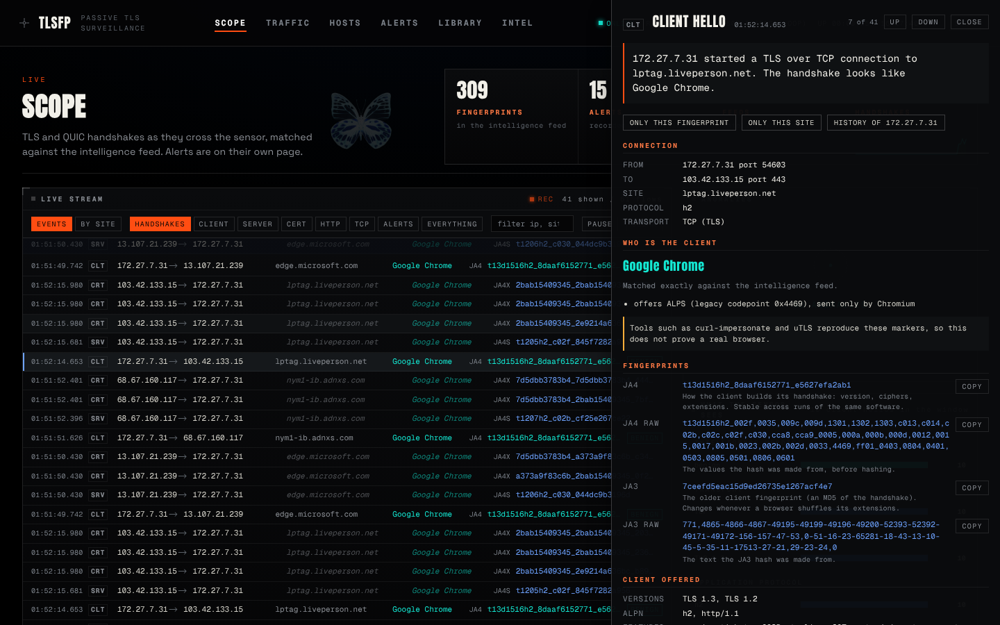
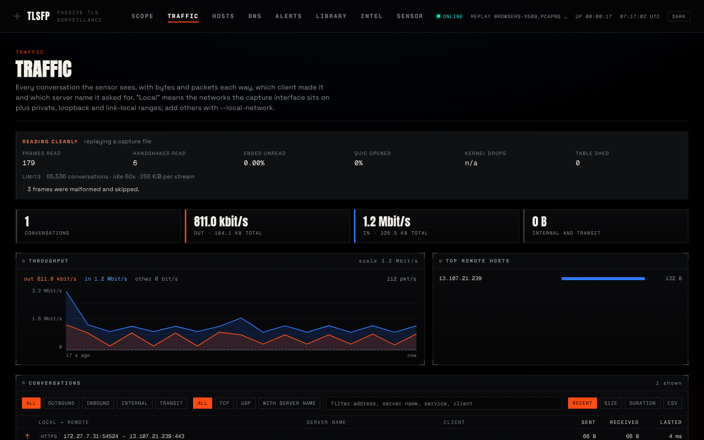

# Dashboard

`tlsfp serve` serves a web dashboard and a JSON API from one process. Every number on it comes from the sensor or the database; nothing is estimated or invented, and a replayed capture says so in the header (backend reachability, the active feed, uptime and your `--location` label).

| Page | What it answers |
|---|---|
| **Scope** | What is crossing the sensor now. Each handshake row names the **site** and the **client**; a server's reply borrows the site from its connection. The **By site** view lists each site with the clients and fingerprints that reached it. Click any row for a side drawer (below). Profiles group the live window by fingerprint or destination and compare two fingerprints side by side. |
| **Traffic** | Each conversation is read left to right: **from** (who opened it: this computer's name or a reverse-DNS name, then address and port), **to** (the domain with its address and port, and a tag saying how the name is known: TLS handshake, HTTP request, DNS answer or reverse DNS), **what** (service, TLS version, ALPN, SSH banner), the client software, and bytes each way. Click a row for a plain sentence ("my-laptop (10.0.0.5) opened an HTTPS connection to example.com (93.184.216.34) on port 443…") and every fact: names and how they are known, TLS version and cipher, JA4 and JA4S, HTTP host and User-Agent, volume, timing. Above the table: a capture health panel (what may have been missed, and which flag fixes it), then every conversation with bytes and packets each way, direction, server name and client, a 15-minute throughput chart kept on the server (full when you open the page), and top remote hosts. "Local" means the capture interface's own networks, private ranges, and `--local-network`. |
| **Hosts** | One profile per machine: which client fingerprints it runs and when each first appeared, the servers it talks to, User-Agent and OS claims, and its alerts. A host that starts presenting a new client is the thing to look at. Servers that only answered are listed separately. |
| **DNS** | The names being asked for (read from plain DNS on UDP 53): most asked names with the addresses they resolved to, busiest hosts, names that did not resolve, random-looking names (a hint, since content networks generate such names too), and recent lookups. Filters and CSV export. DNS over HTTPS or TLS is encrypted and does not appear. |
| **DNS findings** | The DNS page's **worth a look** panel runs six checks over what was heard: a host with many "no such name" answers (20 or more and at least 30% of its lookups); five or more random-looking subdomains under one domain; names of 80 characters or more; a name looked up at a steady rhythm (eight or more queries, gaps within 15% of each other, at least two seconds apart); a name resolving to six or more addresses with a cache time of a minute or less; and names the DNS server blocks. Each finding lists its evidence and what else could explain it, because every one of these patterns has innocent causes. They are shown, not alerted on. The thresholds are named constants in `crates/tlsfp/src/dnsfind.rs`. |
| **Alerts** | Every alert with severity and rule filters, search, a plain explanation of each rule and what to verify, export, and a link to the host. |
| **Library** | Capture files found in a watched folder (`--library DIR`), each read once, named, and downloadable as an HTML report. |
| **Sensor** | How the sensor is set up (source, interface, filter, buffer, limits); the network interfaces it can capture, which one `auto` picks and which is in use, each with a paste-ready command; display preferences (theme, time zone, text size) saved in the browser; data downloads; keyboard shortcuts. Settings that change what is captured are fixed when the server starts, so this page shows the command rather than a switch. |
| **Intel** | What this sensor has seen set against what the feed knows: the share of connections the feed can name, the fingerprints it cannot (with the shape-based guess and the exact command to name them), then the catalogue, feeds and licences. |

## The detail drawer

A plain sentence about the event; the connection; who the client is and why (an exact feed match or a family inferred from the handshake's shape, with its limits); every fingerprint with a one-line explanation and a copy button; what the client offered or the server chose, with registry names; the JA4 breakdown; the other events of the same connection; intelligence; alerts with what each rule means; and shortcuts to filter or open the host's history. `Esc` closes, `j`/`k` or the buttons step.

## Traffic and capture health

The health panel reports `reading cleanly`, `reading with limits` or `losing frames`, with kernel drops, conversations shed and the share of handshakes that ended unread. Details: [`CAPTURE_TUNING.md`](CAPTURE_TUNING.md).

## Behaviour

- **Opens populated:** the server keeps the last 500 events and sends them in one piece on connect.
- **Themes:** dark and light. `/` focuses the stream filter.
- **Serving:** `tlsfp serve` finds the built dashboard on its own ([`INSTALL.md`](INSTALL.md#5-where-things-are-stored)). Hashed assets are cached for a year; the app shell is revalidated on every load, so an upgrade never leaves a stale page.

The screenshots above were taken from a replay of a vendored capture, `testdata/pcap/browsers-x509.pcapng`.
